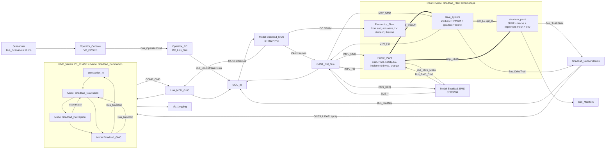

# Shaddad UGV - System Architecture (Simulink, MATLAB R2026b)

| Item | Value |
|---|---|
| Project | MATLAB project `Shaddad_UGV`, `C:\Users\aomar\Desktop\Robot project` |
| Status | Architecture **revision B** (baseline A = synthesis of the seven domain specs in `docs/specs/`; revision B = design-review fixes D30-D63, section 2b), 2026-10-19; the later decisions D64-D122 follow in section 2b (to 2026-11-23) |
| Normative companions | `docs/icd.md` (every bus, port, CAN frame, I/O map; generated), `docs/build_plan.md` (17 build tasks) |
| Data sources | `buses/shaddad_buses.m` + `buses/buses_<domain>.m` (88 buses, validated), `params/shaddad_params.m` + `params/param_<domain>.m` (validated), enum classes `buses/*.m` |

Where a domain spec and this document disagree, **this document and `docs/icd.md` win**. Section 2
lists every resolved conflict so builders know which parts of their spec changed; section 2b
(revision B) overrides section 2 where both speak.

---

## 1. Scope and operating concept

> **Superseded for the scope (2026-11-16) and re-baselined (2026-11-18, D110).** This section predates the as-built robot and is
> kept as the heritage operating concept. The scope of this phase is D76's, with the project charter NASL-SHD-CHR-001
> (`docs/project/charter.md`) as its baseline. The technical baseline is card G1-01's, approved by the project owner on 2026-11-18 (D110):
> the register `docs/requirements/system.yaml` with NASL-SHD-REQ-008 v2.0, the parameters and the as-built record. Where this section differs, they win.

The model represents a NASL-Tech "Shaddad"-class tracked skid-steer agricultural UGV
(curb mass 469 kg with the 16S3P pack, up to 609 kg with a full sprayer; 1.40 x 1.10 m;
gauge 0.85 m; 1.0 m track contact; 2 m/s max; 20 deg slopes; 45-50 C ambient) with swappable
mower / tiller / sprayer implements, working palm farms, greenhouses and solar farms.

Every physical and electronic part is modelled:

| Area | Model content | Owner |
|---|---|---|
| Structure | 6-DOF rigid body (Aerospace 6DOF), 2 x 7-point compliant track contact on a DEM, Dahl-relaxation track shear, sprocket / belt Simscape networks, implement mechanics, environment and dock | structure |
| Battery system | 16S3P LFP pack (Simscape Battery Builder, 15.36 kWh), pack thermal, BMS ECU firmware (STM32G4, Simscape Battery BMS blocks) | power |
| Power distribution | Fuses, shunt, contactors with precharge, hard-wired E-stop safety relay (stop cat. 1 HV, STO immediate), 24/12/5/3.3 V averaged DC-DC rails, implement drives, dock charger | power |
| Traction drive | 2 x 2.5 kW PMSM with commercial CiA-402-style ESC model (1 kHz speed loop, protections, DS402 FSM), 24:1 planetary, spring brake, 3-node thermal | drive |
| MCU | STM32H743 firmware (Embedded Coder + Simulink Coder, multitasking 1/5/10/50/100 ms): SBUS decode, RC mapping, mode manager, safety supervisor and relay re-arm, shaping, yaw-rate loop, skid mixing, torque limits, CAN codecs, watchdog | electronics |
| Electronics plant | DI/ADC front end, watchdog-reset emulation, actuator decoding, LV load demand, enclosure thermal, CAN1 / CAN-FD network emulation, NTRIP link | electronics |
| RC link | Operator -> transmitter -> 2.4 GHz radio (loss) -> receiver failsafe -> SBUS encoder -> UART byte timing | electronics (rc) |
| Sensors | ICM-20948 IMU, dual-antenna RTK GNSS with sky-view fix chain, 3-D LiDAR (fast 2-D band / full 3-D), abstract vision-sprayer detector | sensors |
| Navigation | Companion EKF (11 states: pose, speed, skid, biases, track slip, effective gauge), IMU Filter attitude, gating, nav mode manager | sensors |
| Perception | Scan filter, rolling occupancy map (TEB format), obstacles, protective field, row detection, scan-to-map localisation | sensors |
| GNC | Mission manager, mission compiler (coverage, Dubins headlands), path serving, Pure Pursuit / Adaptive MPC / Stanley, speed governor, corridor + VFH + TEB avoidance (VC_TEB), Hybrid A* replanning, implement manager; packaged with navigation and perception in the deployable `Shaddad_Companion` model | gnc |
| Integration | Top model, plant wrapper, solver / rates / config sets, scenarios S0-S8, monitors, visualisation, regression | integration |

**Phase 1 (RC):** `VC_PHASE = 1`. The operator drives through SBUS; the MCU decodes, maps,
shapes and mixes; the ESCs track speed. The companion is replaced by `GNC_Stub` (no COMP_CMD
frames), so AUTO can never be armed.
**Phase 2 (autonomy):** `VC_PHASE = 2`. With the RC mode switch in AUTO and an arm edge, the MCU
enters AUTO_START (3 s warning) then AUTO and follows COMP_CMD from the GNC. The MCU is always
the final mode authority: RC stick override, MANUAL switch, remote E-stop and every supervisor
fault win over GNC commands. The hardware E-stop chain is independent of all software.

---

## 2. Cross-domain decisions and conflict resolutions

| # | Topic | Conflict between specs | Decision (binding) | Rationale |
|---|---|---|---|---|
| D1 | Stateflow | integration: installed; power/drive/electronics designed charts; sensors/gnc: not installed | **Not installed** (verified: `sflib`/`sfnew.m` exist, but no `Contents.m`, no product XML, not in `ver`; it is the runtime shipped with Simulink). **Every state machine is a MATLAB Function block** with persistent state and uint8 enum classes, written as an ordered transition table so it ports 1:1 to `sflib/Chart` if Stateflow is installed later: BMS mode manager, ESC DS402 FSM, MCU mode manager, RC receiver failsafe, GNSS fix chain, nav mode manager, GNC mission FSM. The electronics PowerSeq chart is deleted (D7). | A chart that cannot be simulated would block every build. MATLAB Function blocks are the only block-based option for multi-state timed logic that is code-generated (Test Sequence is test-only). |
| D2 | Motor-controller split and CAN protocol | drive: ESC closes 1 kHz speed loop, MCU sends speed + torque FF + limit at 100 Hz, IDs 0x200+n; electronics: MCU closes 200 Hz torque-mode speed PI, IDs 0x110.., r_s 0.12, N 20, T_peak 25 | **ESC in SPEED mode (drive design), DRIVE CAN protocol and codecs.** MCU vehicle control runs at **100 Hz** (10 ms task) and adds an **outer yaw-rate PI on the IMU gyro** (Kp 0.4, Ki 2.0, +/-0.4 rad/s authority) so the closed-loop yaw response is first-order with tau about 0.25 s as the GNC MPC assumes. Since D66 the PI rests (reset, u = 0) at commanded standstill. The electronics 2DOF speed PI is dropped. The CMD frame splits the torque limit into `tau_lim_mot` / `tau_lim_reg` (u8, 0.1 N m) so BMS CCL can limit regen without limiting traction; FB2 carries `tau_avail`. Motor parameters: drive values (N 24, r_s 0.128, T_peak 16 N m, J_m 1.65e-3). (amended by D96: provisional, the delivered hardware is the baseline) (the motor and gear values superseded by the as-built record of 2026-10-27 and D95: N 20, r_s 0.090 m, 19.1 N m per side with the 1 kW units) | Commercial traction ESCs close speed loops at 1-4 kHz; a CAN-closed torque loop is sensitive to bus latency and jitter. Yaw-rate feedback answers the GNC open question and removes the 0.6-1.0 skid-steer yaw-gain uncertainty. |
| D3 | Motor encoders | electronics/sensors: STM32 TIM2/TIM5 read encoders, sensors model counts; drive: encoder inside the ESC | Encoders are wired to the ESCs only. Counts reach the MCU in DRV_FB3 (int32, 100 Hz). The **sensors encoder model is removed**; DRIVE models quantisation. The MCU computes odometry (`sens_odom_compute`: 50 ms window difference, 100 Hz) and forwards it in MCU_ODOM. `ENC_x_MISMATCH` compares Delta-count speed with the ESC-reported speed. | One encoder, one wiring harness; TIM2/TIM5 freed. |
| D4 | Contactor / precharge ownership | power: BMS Stateflow sequences K1/K2/K4; electronics: MCU PowerSeq chart drives K1/K2 via DO | **BMS ECU owns K1/K2/K4** (power design, incl. weld check). The MCU sends `HV_Enable_Req` etc. in CAN frame BMS_REQ (0x3D0) and reads `HV_Ready` in BMS_STATE; MCU DO bits for K1/K2 are deleted; `power_ready := HV_Ready`. (amended by D96: provisional, the delivered hardware is the baseline) | Single owner; the BMS has the cell and bus voltages needed for precharge and weld detection. |
| D5 | BMS hardware and CAN map | power: 0x300-0x305 proposed, O1 open; electronics: Pylontech/Victron 0x351/0x355/0x356/0x35A/0x373 | **Dedicated STM32G4 BMS ECU** (`Shaddad_BMS.slx` is its firmware), on CAN1, using the Victron-style frames **plus** 0x3C0 BMS_STATE and 0x3C1 BMS_POWER (layouts in ICD 4). (amended by D96: provisional, the delivered hardware is the baseline) | Keeps SIM-HW parity; a commercial BMS can replace it by matching the standard frames. |
| D6 | CAN modelling | electronics: CAN Pack/Unpack with DBC in common firmware, plant `CAN_Net_Sim`; drive: engineering buses through `drive_canlink` (IDEAL/BYTES), codecs only in HW | **Every ECU encodes/decodes its frames in its common (SIM and HW) logic with `Byte Pack`/`Byte Unpack`**; frames travel as `Bus_CanFrame8` / `Bus_CanFrame64` slot buses (one bus per producer and rate). Plant-side `CAN1_Net_Sim` and `Link_MCU_GNC` (electronics) route, drop (fault injection) and delay frames. No DBC, no `canMessageBusType`. `drive_canlink` and `VC_CANLINK` are dropped. Each frame family has one owner who builds both pack and unpack files: drive (DRV_*), power (BMS_*, IMPL_*), electronics (CAN2). | Codec exercised in every simulation; a single codec technology; raw-data mode matches `stm32blockslib/FDCAN Write` (`DataFormatWriteMode = 'Raw data'`, verified). |
| D7 | LV electronics loads | power: DC-DC 24/12/5/3.3 V + Dynamic Loads from `Bus_LV_LoadDemand`; electronics: own `AUX48_P/N` port with Dynamic Load or DC-DCs | **POWER owns all LV converters and rail loads.** ELECTRONICS has **no electrical ports**; it computes per-rail demand (W) from DO/PWM states and mode (`Bus_LV_LoadDemand`). Brake-release coils are modelled by DRIVE (ESC brake driver on the 48 V DC link, fail-safe); contactor coil holds and pack fans by POWER. | Removes duplicated converters and the second electrical reference. |
| D8 | Safety chain | power: SR flip-flop relay, cat-1 delayed HV, STO immediate; electronics: `Safety_Chain_HW` with K_ok | **POWER `Safety_Chain.slx` is the only safety chain.** Outputs Safety_OK (STO to both ESCs, K3), Safety_HV_OK (K1/K2 coil supply, 1.5 s delay), plus dual-channel `EStop_Ch1_OK`/`EStop_Ch2_OK` for the MCU discrepancy check (all elements of its output bus `safety`, model layout spec 6.3). MCU contributes only `MCU_Safety_OK` (DO0, MCU-internal health, can open, never close) and the re-arm pulse DO1 (**D30**). (amended by D96: provisional, the delivered hardware is the baseline) | One hardware safety function; testable with frozen firmware. |
| D9 | Implements | structure: load mechanics + internal ideal drive; power: Motor & Drive + its own load torque + speed PI; electronics: rotor via CAN, nozzles/pump/lift via MCU GPIO/PWM; integration OQ-01 | Split along the shaft: **STRUCTURE** owns load torque, inertia, chassis wrench, tank depletion, tool-height kinematics; **POWER** owns the electrical drive (Motor & Drive System Level for mower/tiller incl. tiller 12:1 gearbox, 24 V DC pump motor with averaged buck, nozzle and lift electrical loads) and the **implement ECU** (COTS speed loop, CAN IMPL_CMD/IMPL_FB). They meet at the physical port **`Impl_Shaft`**. Rotor speed is commanded over CAN; pump duty, nozzles and lift come from MCU PWM/DO (electronics I/O map). Single variant variable `VC_IMPL` selects both sides. Values: mower 1.00 m, 2800 rpm (293.2 rad/s), J 0.05; tiller 0.60 m, 250 rpm (26.18 rad/s); sprayer 8 nozzles x 0.6 L/min, pump 3000 rpm with D_p 5.3e-7 m^3/rad. | Each physics lives once; matches how real implement drives are built. |
| D10 | Environment / terrain ownership | structure: `P.world` + `structure_env`; integration: `Env_Terrain` + `Bus_Terrain`/`Bus_EnvSlow`; sensors: own `sens_env_build` geometry; different datums and scenario sizes | **STRUCTURE owns one world model `P.world`** (`params/param_world.m`, `utilities/world_build.m`) used by contact, sensors (obstacles, canopy, film, GNSS zones), GNC (rows, boundary, occupancy, dock) and monitors; **`structure_env.slx` is the single producer of `Bus_EnvState`** (T_amb, solar, soil, dock contact). Integration's Env_Terrain is dropped. Datum `[24.1556 47.3120 430]`. Scenarios: palm farm 7 x 13 palms on 8 x 8 m, greenhouse 9.6 x 37.5 m (360 m^2), solar farm with 7 m pitch and 0.8 m table edge. Dynamic obstacles come only from `ScenarioIn.obs`. | One geometry, one datum. |
| D11 | Frames | structure: NED/FRD truth + pose2D; sensors/integration/gnc: ENU/FLU | **ENU / FLU on every bus** (ICD 1). STRUCTURE keeps NED/FRD only inside its 6DOF and converts in `structure_truth.slx`. Origin R = base_footprint = base_link. | Integration rule; ROS REP-103. |
| D12 | Accelerometer sign | integration: MATLAB (negative) convention end-to-end, negate in HW variant; sensors: physical specific force on buses | **Physical specific force on all buses** (sensors), Gain -1 only adjacent to MATLAB sensor/filter library blocks. Gravity `P.frames.g = 9.7876`. Magnetic field in uT. | SIM bus = real driver output, no HW-variant special case. |
| D13 | Rates | integration: {1,5,10,20,100,1000} ms, GNC 20 ms; gnc: base 50 ms, 20 ms forbidden; electronics: 1/5/20/100 ms tasks, 200 Hz control; sensors: odometry 50 Hz | **Allowed set {1, 5, 10, 50, 100, 200, 1000} ms** (+14 ms SBUS frames strictly inside RC_Link_Sim, chained through 1 ms, **D32**). MCU tasks 1/5/10/50/100 ms; GNC 50 ms; NavFusion 5/10 ms; odometry 10 ms with EKF odometry update at 50 ms. | 20 ms and 50 ms cannot exchange data deterministically. |
| D14 | Plant packaging | global: plant pieces as SSR in top model; integration: plant as Model Reference | **`models/Shaddad_Plant.slx` (Model Reference) contains all Simscape networks** as domain SSRs plus the single Solver Configuration; no physical line crosses a Model block. Sensors stay a top-level SSR. BMS is a top-level Model block (an ECU, like the MCU). | Cached accelerator target for the expensive part; physical networks stay in one model. |
| D15 | Solver Configuration / references | power: Solver Configuration + Electrical Reference in PDU; integration: Solver Configuration at plant top | **Solver Configuration at `Shaddad_Plant` top level** (on `DC48_TracL_n`); **Electrical Reference inside `Power_Plant/PDU` at GND after the shunt** (one only). Domain files contain no Solver Configuration; their benches add one. `Electronics_Thermal` (separate network, no ports) has its own. Choices without a motor keep the networks connected through a **network tie (D35)**. | Domain files reusable in benches; shunt never bypassed. |
| D16 | Physical port names | power `DC48_TracL_p`...; drive `DCp_L`...; electronics `AUX48_P`; integration `DC48_p`, `LV24_p` | **`DC48_TracL_p/n`, `DC48_TracR_p/n`, `Spr_L`, `Spr_R`, `Impl_Shaft`** (ICD 2). Classic `foundation.mechanical.rotational` at all mechanical ports (AB only inside the drive brake behind `Interface (AB-Rotational)`). | Every physical port has exactly one mate. |
| D17 | Battery mass and energy | structure 100 kg assumed; gnc E_nom 9216 Wh placeholder | Pack **118.8 kg at [0.05 0 -0.38] m FRD** (box 0.70 x 0.48 x 0.32) feeds `param_structure`; curb mass becomes **469.2 kg**; **E_nom = 15360 Wh** for GNC return-to-home. DRIVE sizing at 600 kg is exceeded by 1.5 % only with a full sprayer (609 kg). (superseded by the as-built record of 2026-10-27, `docs/hardware/real_robot_components.md`, and the parameters: the 13S15P NMC pack, 18.5 kg [EST] and about 2.95 kWh; the robot 220 kg with the 750 W motors and 226 kg with the 1 kW units, D95) | Physics of the selected 16S3P pack. |
| D18 | RC channel map | electronics: CH5 = MANUAL/AUTO/E-STOP; gnc: MANUAL/HOLD/AUTO + aux mission buttons; integration: separate E-stop channel | **CH5 = MANUAL / HOLD / AUTO**, **CH12 = remote E-STOP (latching)**, CH13 = START/RESUME / PAUSE momentary, CH14 = RTH momentary (ICD 7). Failsafe preset: HOLD, disarmed, **E-STOP = RUN** (**D34**). Steering stick right = clockwise (omega < 0). | Satisfies GNC mission commands and keeps a dedicated stop channel. |
| D19 | MCU <-> companion link | gnc: proposed 0x210/0x211 8-byte frames; electronics: CAN-FD set incl. 0x100 COMP_CMD 50 Hz | **CAN-FD (FDCAN2) with electronics frame set adapted to the 50 ms GNC rate:** COMP_CMD 0x100 (32 B, carries `Bus_GncCmd` incl. new `gnc_ready`, `v_ground_est`), MCU_STATUS 0x200, MCU_IMU 0x201 (200 Hz), MCU_ODOM 0x202 (100 Hz), MCU_POWER 0x203 (BMS forward). Companion side = SSR `companion_io` inside `Shaddad_Companion` (SIM codec / HW `ros2lib/Subscribe`/`Publish` via a SocketCAN-FD bridge, **D38**; `ros2lib/CAN Receive` is classic CAN only). | GNC needs IMU, odometry, BMS and MCU state; the BMS is not on CAN2. |
| D20 | AUTO hand-shake | electronics `auto_ready` vs gnc T1 `drive_ready` (circular) | New `Bus_GncCmd.gnc_ready` = GNC healthy (nav ok, plan valid, no fault) even when IDLE. MCU: STANDBY + AUTO switch + arm edge + comp_ok + gnc_ready -> AUTO_START -> AUTO; `Bus_McuStatus.drive_ready` = MCU in AUTO with ESCs ready and HV ready. GNC: IDLE + START + drive_ready -> AUTO_MISSION, `cmd_valid` true. In AUTO with `cmd_valid = false` the MCU holds zero speed (ESC parks after 2 s). | Breaks the deadlock; MCU remains the authority. |
| D21 | RC link loss behaviour | frames with `frame_lost` keep held channels for 1 s before failsafe | `rc_age` restarts only on frames with `frame_lost = 0` and `failsafe = 0`; RC_LINK_LOST after 0.10 s. In AUTO, RC loss is a class-B stop unless `P.electronics.safety.rc_required_in_auto = false` **and** a certified wireless E-stop is fitted (default `true` = stop; single owner MCU, **D44**). | Conservative until a PL d wireless stop exists. |
| D22 | Collision / geofence monitor | structure MF-C MATLAB Function; integration: `robotslcollision` blocks | **`Sim_Monitors` with `robotslcollision/Collision Box`, `Collision Cylinder`, `Check Collision` (verified) in For Each Subsystems** over the 12 nearest static cylinders, 8 nearest boxes incl. film segments (**D42**) and 4 dynamic obstacles. MF-C is dropped. Geofence = GNC; out-of-map flag = Compare To Constant. (superseded by D70: the separation comes from the MATLAB Functions `mon_sep_rect` / `mon_sep_circle` in the For Each blocks; `robotslcollision` is only the test oracle) | User priority: library blocks first. |
| D23 | Perception -> GNC | gnc: separate Obstacle / LocalMap buses, Inf = no return, 0.2 s map | GNC consumes **`Bus_Perception`** (0.1 s, NaN = no return; map field = TEB `MapInfo` in verified order Resolution, GridLocationInWorld, GridSize, OccupancyMatrix, GridOriginInLocal). `person_near := protectiveStop`. GNC treats NaN as no return (corridor compares are false; NaN replaced by 9 m before VFH if the harness shows VFH does not ignore NaN). | One producer bus. |
| D24 | Vision sprayer detector | unowned (sensors Q8) | SENSORS owns an abstract block-based detector `sens_spray_vision` (veg density lookup + Bernoulli p_d 0.90 / p_fa 0.05) producing `Bus_SprayDemand`. | Closes the gap with blocks only. |
| D25 | MCU tilt / NavLite | sensors NavLite IMU Filter on STM32; electronics Complementary Filter | Electronics **Complementary Filter** only, with linear-acceleration compensation (**D47**); NavLite dropped. | No duplicate estimators on the MCU. |
| D26 | Variant names | 20 different names | `VC_*` plain double scalars (ICD 8), created by `shaddad_params`. One `VC_TARGET` for every SIM/HW IO variant. | Variant expressions cannot index structs. |
| D27 | Parameters / buses | single bus file vs per-domain | `buses/buses_<domain>.m` (one owner each) assembled by `shaddad_buses`; `params/param_<domain>.m` assembled by `shaddad_params`; zero ICs in `P.ic` (fast builder `bus_ic`, verified identical to `createMATLABStruct`). No strings in P; descriptive strings in the separate base variable `P_meta` (**D58**). | Parallel builders never edit the same file; MATLAB Function parameters stay codegen-safe. |
| D28 | Regen into a full pack | power O7 / drive Q3 | No brake chopper in v1. MCU sets `tau_lim_reg` from BMS CCL, ESC derates regen at 57-60 V, SOC0 = 0.95 operating rule, speed governor limits downhill speed. Flagged as risk R7. (amended by D96: provisional, the delivered hardware is the baseline) | Avoids an unspecified component. |
| D29 | E-stop category | power cat 1 (HV 1.5 s delayed), electronics cat 0 | STO and K3 open immediately (torque off, spring brakes engage: cat 0 for traction); K1 opens 1.5 s later so implement drives can brake blades regeneratively. Pending safety review (R1). (amended by D96: provisional, the delivered hardware is the baseline) (decided by D86: category 0 for traction, as built) | Keeps stop distance 0.45 m (drive) while stopping blades within 3 s. |

## 2b. Revision B and later decisions (D30-D122: the design review of 2026-10-19 and the decisions since; binding; supersede section 2 and the specs)

Each row closes one or more review findings. "Specs" lists the domain-spec text that the decision
overrides; the build plan carries the resulting instructions. Verification notes are live R2026b checks.

| # | Topic | Decision (binding) | Specs overridden / verification |
|---|---|---|---|
| D30 | Safety-chain re-arm (blocker) | **MCU_SAFETY_OK (DO0) = wdg healthy AND NOT (fault_word AND `maskDO0`) AND mode != BOOT**, `maskDO0` = bits 5-8, 23, 25 (MCU-internal health; since D71, 2026-11-15: bits 5-8, 22, 23, 25). Bits 0, 27, 29, 31 (consequences of the hardware chain) stop the robot but never drop DO0. **DO1 SAFETY_RESET_REQ** = 50 ms monostable (`P.electronics.safety.rearm`) started once automatically on SELFTEST entry and on every reset_req edge (DI RESET_BTN or RC CH9), only after DO0 has been high for 20 ms. `Safety_Chain` stretches the reset edge to 50 ms (`ee_sl_lib/General Control/On-Off Delay`, Td_on 0, Td_off `P.power.safety.t_reset_hold`) so Set = Loop_OK AND Reset_pulse always overlaps. Bit 31 SAFETY_RELAY_OPEN is evaluated only while ACTIVE (outside ACTIVE an open relay only inhibits arming). Power-up sequence normative in ICD 6; S0 checks it. (the automatic re-arm on SELFTEST entry superseded by D91, pending on card G2-MCU) | power 2.5/3.4, electronics 2.7.3/2.7.10/2.7.12, build plan T05.3/T09.5. Root cause verified: P.ic.Bus_PowerHwCmd.MCU_Safety_OK = 0 and maskA bit 31 set made the loop self-locking. |
| D31 | Code-generation toolchain (blocker) | **Simulink Coder is not installed** (not in `ver`; `license('test','Real-Time_Workshop')` = 1, i.e. a seat exists). Every ERT / STM32 / SIL / PIL / External-mode item is **BLOCKED, not failed**, until it is installed; `shaddad_startup` reports the state of Simulink Coder, Embedded Coder, STM32CubeMX and the C/C++ compilers (none installed; only LCC). STM32 board builds move to new task **T17** (CubeMX `.ioc` projects from the NUCLEO-H743ZI2 template, FDCAN bit rates, toolchain). Early codegen checks in T04/T08/T12/T14 use `ert.tlc` + `GenCodeOnly` with a generic ARM device, no HardwareBoard. (overtaken 2026-11-07: Simulink Coder and Embedded Coder are installed, and MinGW64 14.2.0 is the C compiler; the STM32 tools are still missing, card B-00; the blocker resolved by D121, 2026-11-23) | arch 7, electronics 8.3, T04/T08/T12/T14 acceptance. Verified: `ver` lists Embedded Coder, MATLAB Coder, STM32 blockset but not Simulink Coder; `mex.getCompilerConfigurations` finds no C or C++ compiler. |
| D32 | Rate transitions | (a) Deterministic RTs need integer rate ratios: inside `RC_Link_Sim` the 10 ms inputs go 0.01 -> 0.001 -> frame period (14 or 7 ms); `rc_frame` leaves `RC_Link_Sim` at 0.001 (RT), so 0.014/0.007 never cross a file boundary; compiled-rate audits use `P.sim.Ts_compiled_allowed`. (b) `structure_plant` output `impl_mech` is declared at 0.01 with an internal Zero-Order Hold. (c) `MissionCmd_RT` (0.01 -> 0.2), in the top-level component `GNC` (`Shaddad_System/GNC/MissionCmd_RT`, model layout spec 5.2), feeds `GNC_Variant` in9 through `Spec_GNC_mcmd`. | ICD 3.1/3.2, T01, T03, T07. |
| D33 | Deceleration chain | **The MCU shaper is the only deceleration limiter.** ESC setpoint ramp `P.drive.esc.a_max` = 420 rad/s^2 (2.24 m/s^2) and QUICK_STOP `a_qs` = 375 rad/s^2 (2.0 m/s^2) (with the as-built gear, N 20 and r_s 0.090 m, the same 2.24 and 2.0 m/s^2 are 497.8 and 444.4 rad/s^2, `params/param_drive.m:73`) are above every MCU profile (assert in `shaddad_params`). CTRL_STOP and ESTOP.DECEL use the constant-deceleration law `a_dem = -sign(x_ref)*min(a_stop, sqrt(2*j_stop*abs(x_ref)))` (no proportional tail). Replay (10 ms shaper + 1 ms ESC first-order 40 ms): MANUAL release from 1.2 m/s 0.88 m incl. 60 ms latency; remote E-stop from 1.2 m/s 0.62 m incl. 92 ms worst-case latency; CTRL_STOP from 1.0 m/s 0.71 m incl. 128 ms detection. S1/S6/S8 criteria re-derived from these numbers; GNC `t_lat` = 0.35 s in `d_stop_req`. | drive 2.9 (ramp 150/280), electronics 2.7.5, arch 10.3 (1.5 m/s^2), S1, S8(b), T-EL-28. |
| D34 | RC failsafe semantics | Receiver failsafe preset CH12 = 172 (RUN). REMOTE_ESTOP is evaluated only on frames with failsafe = 0 and frame_lost = 0 (held otherwise) and has a single 40 ms persistence (no tapped-delay channel debounce). Failsafe is RC_FAILSAFE (class B); link loss is RC_LINK_LOST (class B). A failsafe can never latch ESTOP. | D18, ICD 6 bit 1, ICD 7, param_rc. |
| D35 | Simscape network connectivity (blocker) | One Solver Configuration stays the rule (D15). Every mechanical/thermal node must belong to the DC48 network in every variant combination: choices and stubs without a motor (`Impl_None`, `drive_plant_ideal`, T01 stubs of `drive_system` and `Power_Plant`) contain a **network tie** (`fl_lib/.../Rotational Electromechanical Converter`, K = 1e-3 V s/rad, loaded by a 1 MOhm `ee_lib/Passive/Resistor` to DC-; thermal variant `ee.passive.resistor_thermal` where a thermal node must be tied). T01 compiles the plant for VC_IMPL 0..3 x VC_DRIVE_FID {1,3}. | ICD 2, T01.3, power 3.6 (Impl_None), drive 2.11 (IDEAL). Verified: converter block exists (4 ports, parameter K), `ee_lib/Passive/Resistor` has ComponentVariants `ee.passive.resistor` / `ee.passive.resistor_thermal`. |
| D36 | Loop breakers (explicit, tasking-independent) | A Simscape network with a local solver is treated as direct feedthrough. Explicit 1-sample Unit Delays: every ESC -> plant S-PS input (Tr, brake coil; `P.drive.esc.cmd_delay`, real ESC compute delay, PM change 1.4 deg); implement-ECU torque reference (0.01 s); belt speed in the shear damping term (`P.structure.track.vb_delay`); implement load-torque speed inputs (structure, 1 ms); dock-charger voltage feedback (1 ms); `Electronics_Plant.elec_hw` (1 ms, DI sampling latency) in addition to `hw_cmd`; CAN2 MCU_STATUS (D41). At the top level the breakers sit in the component whose timing they model (model layout spec 5.2): `Shaddad_System/Plant/ElecHw_Delay` (1 ms, published once as `plant.elec_hw_d`), `Shaddad_System/BMS/BMS_Cmd_Delay` (published as `bms.cmd_d`), and `EscFb_Delay`, `EscSlow_Delay`, `Impl_Delay`, `Bms_Delay` and `Adc_Delay` in `Shaddad_System/MCU`, in front of `MCU_In`. Loop breaking therefore no longer depends on slow-to-fast RT semantics, which differ in single-tasking (`cs_SimRef`). T03/T05/T06/T10 benches and T01 run `Simulink.BlockDiagram.getAlgebraicLoops` (expect 0). | arch 6.2, ICD 3.2, T03/T05/T06/T10. |
| D37 | RC latency budget | Measurement points: **TX frame emission (transmitter sample) -> DRV_CMD frame at the MCU output**: 14 ms (frame RT = radio latency, `P.rc.latency_frames` = 1 total, explicit Delay length 0) + 3 ms bytes + <= 1 ms poll + <= 10 ms Task_10 phase = 18-28 ms (S1 limit 30 ms). Operator stick (ScenarioIn) -> ESC speed reference: + 10 ms input RT + 0-14 ms frame phase + 10 ms ESC RT = 38-62 ms (S1 limit 65 ms). RF loss -> CTRL_STOP <= 0.13 s (= 0.10 timeout + 14 + 3 + 1 + 10 ms). | arch 6.2, integration E5, S1, S6. |
| D38 | Companion deployment and CAN-FD | `models/Shaddad_Companion.slx` (Model reference, the single deployable companion top) holds `companion_io` + NavFusion + Perception + GNC Model blocks; `GNC_Variant/Companion` contains only this Model block. `cs_Companion`: ert C++, `HardwareBoard 'Robot Operating System 2 (ROS 2)'` (verified settable). `companion_io` HW uses `ros2lib/Subscribe` `/can2/rx` and `ros2lib/Publish` `/can2/tx` with `std_msgs/UInt8MultiArray` (69 B: id, len, 64 data bytes) from an external SocketCAN-FD bridge node; CAN-FD frames stay as specified. SIL of the C++ models needs a C++ compiler (none installed). | D19, R13, T10.9, T12-T15. Verified: `ros.slros2.internal.block.CANReceive.set.MsgLength` validates `<= 8` (classic CAN only); NVIDIA Jetson is not a registered board. |
| D39 | Track shear model and gauge factor | Per contact point an **isotropic 2-D shear state** s_j = [s_x; s_y] (28 states) driven by the resultant slip velocity v_slip,j = [v_b,i - v_x,j; -v_y,j]: `ds_j/dt = (v_slip,j - abs(v_slip,j)*s_j)/K_j - (abs(v_b,i)/l)*s_j`, `F_j = mu_j N_j [g(abs(s_j)) s_j/abs(s_j) + tau_d ds_j/dt]` saturated at mu_j N_j, mu_j on the (mu_p, mu_lat) friction ellipse along s_j; sprocket load F_x,i = sum of F_x,j over the track. Straight-line behaviour (T4) is unchanged; turning now forces longitudinal slip (Wong). `P.structure.track.chi_nom` (provisional 1.40) is identified by T03 from the HiFi model and is the single source of `P.electronics.mix.chi`, `P.sensors.ekf.chi0`, `P.structure.lofi.chi` and the GNC limits (asserted). | structure 2.5, 2.6, 3.2, 4.2, T9, T10, T18. Old model gave chi_eff 1.01-1.08 (review fixed-point solve) vs 1.35-1.4 assumed. |
| D40 | Energy audit | Integrals at 1 ms inside the plant: `Bus_PowerTruth` E_trac_dc_Wh, E_impl_dc_Wh, E_lv_Wh, E_dcdc_loss_Wh, E_pdu_loss_Wh, E_chg_bus_Wh, I_pack_peak_A; `Bus_DriveSideTruth` E_spr, E_loss; `Bus_StructureDiag` E_diss_J, E_impl_shaft_J. **eps_el** = abs((E_out - E_in) + E_chg_bus - (E_trac_dc + E_impl_dc + E_lv + E_dcdc_loss + E_pdu_loss))/max(E_out, 1 Wh); **eps_mech** = abs(sum(E_spr) - E_diss - dE_mech)/max(sum(E_spr), 1 kJ) with dE_mech from struct_diag.E_mech. Both <= 1 % (S3, T-INT-08); I_batt_peak from the 1 ms running maximum. | integration E4, Bus_SimKPI, T16. |
| D41 | GNC <-> MCU timing | The CAN2 loop breaker moves from COMP_CMD to **MCU_STATUS** (Link_MCU_GNC one-sample delay, `P.electronics.can.can2_status_delay`); COMP_CMD is undelayed, so GNC -> Task_10 = 50 ms (Task_50 -> Task_10 RT) and GNC -> ESC about 60 ms (was 110 ms). In AUTO the MCU yaw shaper uses `K_w_auto` 20 1/s, `alpha_auto` 3.0 rad/s^2, `jw_auto` 30 rad/s^3 (above the GNC limits: safety envelope, about 0.05 s lag). The MPC prediction model adds `P.gnc.mpc.n_delay` = 2 input-delay samples (0.1 s) to tau_r; the T14 bench includes the dead time. | ICD 3.1/5, gnc 2.3, T10.8, T14. |
| D42 | Collision / clearance monitor | `Sim_Monitors` checks the footprint against K_c = 12 nearest cylinders, K_b = 8 nearest boxes (`robotslcollision/Collision Box` with yaw, from `P.world.obstacles.box`; film segments as 0.02 m thick boxes) and 4 dynamic cylinders, in For Each Subsystems; `clear_min` is the minimum over all. S5's test box is appended to `P.world.obstacles.box` by `scn_S5` before the run (occupancy rebuilt with `world_occupancy`). (superseded by D70: the separation comes from the MATLAB Functions `mon_sep_rect` / `mon_sep_circle`; `robotslcollision` is only the test oracle) | D22, T16.1, S4, S5. |
| D43 | GNC command envelope | GNC limits are derived from the MCU: `P.gnc.spd.v_max = min(2.0, P.electronics.lim.v_max_auto)` = 1.5 m/s; CommandShaping enforces `abs(v) + abs(omega)*chi*B/2 <= v_track_max` with chi, B, v_track_max from `P.electronics`; `Bus_GncCmd.v_cmd` range [-0.5, 1.5]. Asserted in `shaddad_params`. (restated, 2026-11-18: the formula stands; with `lim.v_max_auto` 1.2 m/s it gives 1.2 m/s today, REQ-SYS-029; the `Bus_GncCmd.v_cmd` range [-0.5, 1.2] m/s is pending on card G2-GNC, see the ICD's notes to section 10) | gnc 2.1/2.7 (B/2 = 0.425), T14 T4. |
| D44 | RC loss in AUTO | Single owner: `P.electronics.safety.rc_required_in_auto` = **true** (default stop, D21); the MCU applies it (ACTIVE -> CTRL_STOP on NOT rc_ok, except in AUTO when the flag is false, which is allowed only with a certified wireless E-stop fitted). `P.gnc.fsm.rc_required_in_auto` is removed; the GNC FSM derives HoldReason RC_LOSS from `Bus_McuStatus.rc_link_ok`. | D21, gnc 6 (fsm.rc_required_in_auto). |
| D45 | Charging at 45-50 C | The dock supplies conditioned air (`P.power.thermal.dock_air`: 30 C, fans forced on) while docked; `Pack_Thermal` switches its fan-inlet temperature to it on `env.dock_contact`. The BMS hot-charge table is re-based on the LFP cell datasheet (charge window 0-55 C, <= 0.5C per cell): 100 A up to 50 C, 50 A at 55 C, 0 at 60 C (old table gave 61.6 A at 49.8 C, contradicting the 90 A shift plan). New tests T-PWR-10b (50 C, 600 W/m^2, dock air on: 0.10 -> 0.95 <= 3.6 h, T_cell <= 45 C), T-PWR-10c (dock air off: report, <= 4.5 h, T_cell <= 55 C) and T-PWR-20 (24 h shift-cycle bench, >= 3 shifts/day at 45 C and 50 C). (amended by D96: provisional, the delivered hardware is the baseline) (superseded by D101) (the dock air and the hot-charge table superseded by D94 and D97) | power 2.3 (self-inconsistent hand calc), 6.8, 8. |
| D46 | Shift duty and power budget | Design shift = 4 h with 70 % cutting at the site working speed and 30 % transit/turn with the implement off; worst site = palm farm on farm soil. Recomputed with the D9 mower model (review): cutting 2352 W, non-cutting 979 W at 1.0 m/s, average 1940 W = 7.76 kWh/shift. Usable window 0.95 -> 0.215 (SOC0 rule D28 to soc_rth) = 0.735: EOL 8.76 kWh (+13 %), BOL 10.95 kWh. At 1.2 m/s the EOL budget fails (-1.7 %), so **`P.gnc.spd.v_work_palm` = 1.0 m/s** and the governor limits speed in dense vegetation (`spd.veg_x/veg_v`). Continuous 4 h cutting at 1.2 m/s would need 16S4P (+32 kg). S3 starts at SOC0 = 0.95 and requires SOC_end >= soc_rth. (superseded by D101) | power 2.1 (1.0 kW mower, 90 % window, "22 % margin"), S3. |
| D47 | MCU tilt estimate | `fw_imu_tilt` subtracts the measured linear acceleration [a_track; v*omega_z; 0] (encoder-speed derivative, first-order 0.05 s) from the physical specific force before the Complementary Filter; tilt faults are evaluated only while abs(a_track) < 0.3 m/s^2 or after the 0.5 s persistence. S2 checks that no tilt fault occurs during start/stop on the ramp. | D25, electronics 2.7.10 bits 14/15. |
| D48 | BMS estimation at end of life | `batt_sl_lib/Estimators/SOC Estimator (Kalman Filter, Variable Capacity)` (inports Current, CellVoltage, CellTemperature, CellAH, InitialSOC; verified), `SOC Estimator (Coulomb Counting, Variable Capacity)` and `SOE Estimator (Energy Counting, Variable Energy Capacity)` (Current, Voltage, EnergyCapacity, InitialSOE; verified) replace the fixed-capacity blocks; CellAH and E_nom come from the Battery Capacity Estimator / SOH output (rate limit 1e-3 Ah/s, bounds [200 310] Ah). New EOL test: capacity x 0.8, R0 x 1.5: abs(SOC_est - SOC_true) <= 0.03. | power 3.9 E7/E8/E12, T-PWR-11/13. |
| D49 | Navigation error model | IMU temperature coefficients set to the ICM-20948 datasheet values (gyro 8.7e-4 rad/s/K, accel 7.8e-3 m/s^2/K; check against the revision in use); EKF bias process noise qc(7) 1e-8, qc(8) 2e-6. Slip states: prior s0 = 0.005, and during GNSS + scan-match denial they are held (tau_s_denied 1e6 s, prior mean = estimate at denial onset, slip process noise 2e-6) through the EKF state-transition input u and the time-varying process-noise port (`HasTimeVaryingProcessNoise`, verified). New S7 variants: farm and wet soil, and a 10 K enclosure temperature ramp. | sensors 3.2 (stale N_g/r_s line), 3.5, 6 (ekf, imu). |
| D50 | ESC speed loop | Re-tuned on the two-mass model (belt side J_b = 2.583e-3 kg m^2 at the motor, shear spring k_x = mu_p N/K, c = tau_d k_x, 5 ms torque lag, 2 ms filter, 2.5 ms delay incl. the D36 delay): **Kp_w = 0.13, Ki_w = 0.39**. Computed (Control System Toolbox): rigid wc 14.3 rad/s PM 70 deg; two-mass on farm/sand/wet/asphalt at 469 and 609 kg: PM >= 63 deg, GM >= 14.6 dB, Ms <= 1.43, closed-loop zeta >= 0.43 (old gains: PM 41 deg, GM 8.6 dB, Ms 2.04, zeta 0.19). With the MCU shaper + torque feedforward the vehicle-speed overshoot is < 0.1 % for both. The drive bench gets a two-mass load (`P.drive.bench2m`). Tc stays 5 ms until the ESC is selected. (re-tuned by D64 for the four-motor robot: Kp_w 0.030, Ki_w 0.090) | drive 2.9 (Kp 0.255, Ki 1.59), 7, 8. |
| D51 | Gearbox rating | Planetary T2N >= 280 N m (pivot 222, adhesion 264 N m), T2B >= 380 N m (>= 16 x 24 x 0.94 = 361 N m), T2NOT 560 N m (`P.drive.gear`); asserted. Gearbox load spectrum (time at torque bins) logged in drive T9 and S2. (the figures are the former single-motor drive's; the four-motor side ratings, 2 x `u.gear_T`, are 240 / 360 / 480 N m with the 1 kW units and 240 / 280 / 480 N m with the 750 W, and meet the rule that `shaddad_params` asserts) | drive 1 (200/400 N m), 6. |
| D52 | Drive variants and thermal ports | `VC_DRIVE_FID` in the system is 1 SYS or 3 IDEAL; FOC (Ts 1e-4 / 5e-5 s, outside the rate set) is **bench-only** (`tests/drive/tb_drive_foc`), rejected by `shaddad_params`. Every drive_plant choice exposes the same thermal port H to `drive_thermal` (IDEAL: Controlled Heat Flow Rate Source of its loss + thermal network tie). Thermal ports may connect child SSRs inside one domain top SSR; build rule 6 adds `'Connection: foundation.thermal.thermal'`. | ICD 1, drive 2.11/7, build rule 6. |
| D53 | Turning on slopes | CommandShaping limits omega by tilt: `P.gnc.cmd.w_tilt_x/w_tilt` (1.2 rad/s below 8 deg -> 0.2 rad/s at 20 deg); ALIGN pivots are inhibited above 10 deg pitch or roll; the mission compiler places no headland turns or Dubins bulbs where the slope exceeds `P.gnc.cov.slope_turn_max` (10 deg). New structure test T7b: R = 2 m turn on 15 deg and 20 deg slopes, farm soil, 609 kg: no downhill slide > 0.1 m. | gnc 2.6/2.7, structure 8. Review: outer track needs ~1950 N vs 1850 N available. |
| D54 | Greenhouse inset | `c_in = gh_post_edge + gh_c_clear + gh_c_xte + max(0, W/2 - w_tool/2)` = 0.20 + 0.15 + 0.05 + 0.05 = 0.45 m (posts r 0.05 at x = 0.15 / 9.45). S4 coverage is measured on the floor inset by c_in. Stale raised-bed geometry (0.25 m beds, 1.4 m paths) is removed from the mower mission. (the inset superseded by D106) | gnc 2.7 (c_in 0.15/0.20), structure 6.9. |
| D55 | Scan-to-map localisation cost | `matchScansGrid` with `Resolution` 10, `MaxRange` 10 m, `TranslationSearchRange` [0.3 0.3], RotationSearchRange 0.1745, 5 Hz only while `lidarLocOn`. Measured in this session (interpreted, 9.6 m aisle, 268 points): **29 ms** per call with the correct pose, vs 18.6 s with MaxRange 30 / Resolution 20 (review). T13 runs the timing test first. | sensors 3.7 / F11 (81 ms claim), param_sensors per.sm*. |
| D56 | Simulation speed | Estimated cost per simulated hour: Phase 1 4-9 min, Phase 2 13-26 min (LCC adds 1.5-2x). Measures: (1) **endurance fidelity set** `P.sim.endurance` (Lumped pack, VC_DRIVE_FID 3, VC_STRUCT_FID 2, LiDAR/perception 5 Hz, VC_TEB 0, VC_VIZ 0) for S3; (2) missions run the **top model in Accelerator** (top-level 1 kHz SSRs compiled) with all Model blocks in Accelerator; (3) new `VC_TEB` (0 removes the interpreted-only TEB so rapid accelerator is possible); (4) install MinGW-w64 before any RTF acceptance; (5) targets re-baselined: S1 RTF >= 5 (10 with MinGW), S3 RTF >= 4, confirmed by Simulink Profiler runs in T01/T03/T16. TEB runs only in Normal/Accelerator, only inside the BYPASS-enabled subsystem, on a 10 x 10 m window at 5 cells/m. (measure 2 was overtaken while Windows Code Integrity blocked unsigned accelerator MEX files on this PC, STATUS 20; that block resolved by D121: Smart App Control is off since 2026-11-22, and accelerator runs work; measure 4 done: MinGW64 14.2.0; the VC_TEB default is 0 by D99) | arch 7 speed plan, integration 7.7, T-INT-03. Verified: TEB `getSimulateUsingImpl` returns "Interpreted execution". |
| D57 | GNC mission plan | No `plan` root inport on `Shaddad_GNC` (a Model block input cannot have constant sample time). A Constant `MissionSource` inside `Shaddad_GNC` reads `P.gnc.mission` (`Bus: Bus_MissionPlan`); HW later replaces it with a ROS 2 subscription inside an IO variant. Removes the 0.84 MB bus from the Model boundary. | ICD 3.1 GNC row, T01, T14. |
| D58 | Parameters, runs and workers | `cs_SimFixed` uses `DefaultParameterBehavior 'Tunable'` (codegen sets `Inlined`); P is numeric/logical only (verified: 0 non-numeric fields); descriptive strings move to base variable **`P_meta`**; MATLAB Function blocks receive sub-structs only (never P). `shaddad_startup` also runs `gnc_designMPC(P)` when it exists and VC_ROW_TRACKER == 1; `run_all_scenarios` groups runs by world + variant set (dimension changes force rebuilds), uses Fast Restart only within a group, and passes `'SetupFcn', @() shaddad_startup('quiet')`, `'TransferBaseWorkspaceVariables','off'` to `parsim`. `run_scenario('ref')` switches `UseLocalSolver 'off'` on both Solver Configuration blocks (block parameters, not ConfigSet) and restores them. | D27, arch 7/9, integration 7.4/7.8, T01, T16. |
| D59 | Library blocks instead of MATLAB Functions | `rx_failsafe` becomes blocks (Switch + Unit Delay hold, Discrete-Time Integrator loss timer with reset, Compare To Constant, Multiport Switch on `P.rc.rx_failsafe_mode`); `sens_env_skyview` becomes two `2-D Lookup Table` blocks on the precomputed `P.world.gnssSvf` / `gnssZoneId` grids (built by `world_build`); `sens_scan_filter` and the sector-minima / protective-field part of `sens_obstacle_extract` become element-wise blocks (Trigonometric Function, Relational/Logical Operator, Switch, Selector, Reshape, `dspstat3/Minimum`); only the segmentation loop stays in code. | arch 11, sensors F1/F7/F9, T07/T11/T13. |
| D60 | MCU HW inputs and bus-off injection | HW `IO_In` sources: `t_us` = Register Read TIM2 CNT (1 MHz), `reset_flag` = Register Read RCC_RSR IWDG1RSTF, bus-off = Register Read FDCAN_PSR.BO. SIM: `Bus_FaultInject.can1_busoff/can2_busoff` -> `fault_inject` b4/b5; CAN1_Net_Sim / Link_MCU_GNC drop the affected frames. | ICD 6, T08, T10. |
| D61 | LV rail assignment | 24 V: beacon, work lights, 3D LiDAR (LIDAR_PWR_EN). 12 V: MCU board, Jetson, LTE/NTRIP modem, cameras, display, enclosure fans. 5 V: RC receiver, both GNSS receivers. `gnssCorrOK` keeps its Rail_12V_OK dependency (modem on 12 V). | Bus_LV_LoadDemand descriptions, T10.5. |
| D62 | Minor consistency fixes | HV_LOST persistence 0.2 s in params; T12 depends on T11 only because `sens_acq_imu` / `sens_odom_compute` move to T11 (sensors-owned files); E-stop latency criteria measured from the plant-side hmi (Plant_In output); `Flat Earth to LLA` href is an input port (Constant `P.world.lla0(3)`); `VC_OPSRC = 3` (`vrlib/Joystick Input`, Simulink 3D Animation not installed) gets a 2 s smoke test in T16 before use. Process rule: every MATLAB variable an agent creates in the shared base workspace carries its prefix, including loop indices and `catch` variables. (the process rule superseded by the team's work rules of 2026-11-16: nothing is assigned in the shared base workspace) | ICD 6, T03, T08, T11, T12, T16, build rule 1. |
| D63 | Navigation EKF rate structure | `cstblocks_estimation/Extended Kalman Filter` keeps its state and covariance in Data Store Memory (verified: 2 DataStoreMemory, 6 reads, 4 writes inside the block) and a fresh ConfigSet has `MultiTaskDSMMsg = 'error'`, so multirate corrections in a multitasking model are likely to fail. **`EnableMultirate = 'off'`**: predict and all five corrections run at 0.01 s, each correction gated by its enable port (`sens_nav_gate` en(j) true only on a new measurement), measurements rate-transitioned up to 0.01 s (slow-to-fast RT + new-data flag). The navReset behaviour (T-NAV-09) is the first T12 test; the MATLAB System `extendedKalmanFilter` fallback (R6) stays ready. (superseded in T12: the fallback was taken, because the Resettable Subsystem does not re-initialise the block's Data Store Memory; the EKF is the MATLAB System `sens_nav_ekf`, `build_navfusion.m`; R6 closed) | sensors 4.3.1 (multirate), T12. |
| D64 | Drive tuning, brake model and benches for the four-motor robot | (1) **Speed PI re-tuned** for the four-motor drive on the D50 two-mass model (`tb_drive_2mass_lti`, k_x 40 / 61 / 540 kN/m, m_side = robot alone / full sprayer): **Kp_w = 0.030, Ki_w = 0.090** (Ki/Kp = 3 as in D50; rigid crossover 8.0 rad/s). kw1 x 4: PM 62 deg, GM 15.0 dB, Ms 1.37, zeta 0.57; movematic750 x 4: PM 63 deg, GM 13.1 dB, Ms 1.46, zeta 0.51 (T21 bounds Ms <= 1.6, zeta >= 0.35). The D50 gains scaled with J_eq gave Ms 1.65 (one motor per side: Ms 2.25, zeta 0.25); a first re-tune with Ki 0.060 left about 0.2 N m in the integrator after a controlled stop, so S6a / S6b reached standstill only after 1.63 s (limit 1.5 s). (2) **Elasto-plastic brake**: the Rotational Friction (AB) of `drive_brake` is replaced by the Simscape component `shaddad_drive.elastoplastic_brake` (`subsystems/drive/+shaddad_drive`, Simscape Component block): a bristle (LuGre-type) state holds the shaft as a torsional spring (k_b 25 N m/rad, c_b 0.15 N m s/rad per brake) below mu_s r N and slides with the Stribeck curve to mu_c r N; the torque scales with the engagement N/(N + N_eps), so a released brake transmits nothing, and the bristle relaxes at w_r k_b z / g (creep w_r T / g). The friction element changed the sign of its torque at every 1 ms step (Backward Euler, 3 nonlinear iterations) when engaged at standstill; with two 5 N m brakes per side this grew into a limit cycle on the 158 kg bench (T9 sprocket peak 859 N m, T10) and diverged in the system (S8a: right rotor 3400 rad/s in ESTOP, FAULT after the reset; D2). A wider breakaway velocity (0.02 x n rad/s) held on the bench but not in the system. With the new brake: T9 156 / 164 N m, T10 2.03 m/s^2, T8 creep 0.0004 m/h (|w_m| 2.4e-5 rad/s). (3) **Bench load follows P**: `tb_drive_run` sets `tb_J`, `tb_Trr`, `tb_Jb_spr` from the P of every run (`tb_drive_load`); the benches had kept the 300 kg / 0.128 m load of the former robot since they were built. | drive 2.7, 2.9, 3.3, 8 (T1, T2, T8, T9, T10, T21, T22); scenarios S6a, S6b, S8a, D2; docs/hardware/real_robot_components.md. |
| D65 | BMS warnings inform, they do not derate | MCU bit 11 BMS_WARN (BMS warning word ≠ 0, or DCL < 25 A, `dcl_warn`) stays a warning but no longer derates: `derate_bms_warn` 1 (was 0.5), and bit 11 leaves class C, so it is info only (`params/param_electronics.m`). The BMS limits reach the drives only through the torque limiter: DCL limits motoring, CCL limits regen (spec electronics 2.7.9, D2). Why: the fixed 0.5 halved the speed cap, the yaw-rate cap and the motoring torque limit for FAN and for a charge-only CCL derate. At the 45 °C design ambient that was the whole day (0.71 m/s instead of 1.0) with the pack current below 14 % of DCL, and at 55 °C it counted DCL twice. Approved by the user on 2026-10-29 (assessment of 2026-10-28); applied 2026-11-12. | ICD section 6 and spec electronics 2.7.10 (the bit 11 row: DCL < 25 A, info). Verification: `t_mcu_control` T-EL-11 (case 2 without the 0.5, a new case with CCL = 0) and T-EL-13; row tests at 45, 55 and 30 °C; `phase1_quick`. Real robot: this relies on the BMS sending live DCL / CCL that follow temperature and SOC (0x351); confirm it for the XMachines BMS (supplier data, or a CAN log at 45 °C or more). |
| D66 | The MCU yaw loop rests at commanded standstill | In `fw_vehicle_ctrl` (`scripts/build/build_fw_control.m`) the new subsystem `Cmd_still` is true when `v_target = w_target = 0` exactly, `\|v_ref\| < yaw.cmd_still_v` and `\|w_ref\| < yaw.cmd_still_w` (both 0.005), or when the drive is disabled. At commanded standstill the yaw-rate PI of D2 resets (integrator 0, u = 0). The gyro re-bias average in `Yaw_meas` learns only while both tracks are below `yaw.standstill_v` and `Cmd_still` held in the previous step; the Unit Delay avoids an algebraic loop through the `Shaper_w` reset. The drive-disabled term keeps the old gate while the drive is off (then `w_ref` copies the measured yaw rate), so the bias is learned before the first enable; without it, the robot would start with an unlearned bias and turn briefly at the bias rate. Why: in S4 (2026-11-13) a residual PI integrator held a pivot of about 0.0105 m/s per track in every GNC pause, under the 0.02 m/s standstill gate. The re-bias absorbed the 1.7 deg/s spin, so the loop saw no error. The robot turned 145 deg in one pause and 4.2 turns between 464 and 1365 s, and the rejoin replanner failed. Approved by the user on 2026-11-14 ("All three, MCU first"); applied and reviewed on 2026-11-14. | Spec electronics 2.7.6 and 8.2 (T-EL-43). Verification: `t_mcu_control` T-EL-43 (a 61 s pause after a turn: heading change 17.06 deg before, 0.000 after) and the TEL single tests; the 30 °C row test is unchanged. `fw_imu_tilt` (Task_5) keeps the measured-only gate: its bias reaches only the telemetry `yaw_rate_meas`, and gating it would change Task_5 ports. The bench gyro has no bias, so no test shows the new gate opening. Real robot: regenerate and flash once the STM32 tools are installed. The companion must send exactly 0.0f in a pause; otherwise the PI and the re-bias behave as before. Check: hold AUTO with the GNC paused for 2-5 min, logging `w_mix − w_ref`, `vtrack_ref` and the heading. |
| D67 | The GNC rides out the ESC unpark and turns round before it rejoins | In `subsystems/gnc/gnc_missionFSM.m`: (1) **T36 waits** until `drive_ready` has been false for `fsm.t_drive_lost` = 0.5 s, in AUTO, OBSTACLE_HOLD and RTH; with the RC link also lost it still pauses at once (RC_LOSS, D44). T1, T2 and P3 keep the raw `drive_ready`, which a parked ESC reports as true. (2) **Resume pivots in place:** `local_resume` goes to ALIGN instead of REJOIN when the robot is on the lane (\|e_y\| < 0.3 m) but at least `resume_epsi` (30 deg) off, the segment allows pivoting (seg column 10, tilt within `align_tilt`), and the pause did not interrupt a bypass, a rejoin or the dock approach. (3) **GLOBAL fallback for rejoins:** when the LOCAL plan of an ordinary rejoin fails, the FSM asks for a GLOBAL plan to the same goal; only a failed GLOBAL plan counts as a try (3 pairs, then PLANNER_FAIL). A bypass, its TEB rejoin and a rejoin resumed from a paused bypass stay LOCAL (`laneOnly`), as spec 8 T7's lane rule asks. Why: since D66 the ESCs park at zero command, and their 0.1 s unpark (ENABLING) dropped `drive_ready`, which T36 turned into a permanent OPERATOR pause (S4 stopped at 15.4 s). In the S4 run of 2026-11-13 the rejoin after the long pause faced 175 deg off lane 5, and the forward-only LOCAL planner failed three times (PLANNER_FAIL at 464.2 s). Approved by the user on 2026-11-14 ("Yes, GNC then nav"); applied and reviewed on 2026-11-14. (the resume pivot superseded by D87: only where the footprint fits) | Spec gnc rows T36, REJOIN, P1/P2, 4.4 retry policy, `fsm.t_drive_lost`, T11 checks. Verification: `t_gnc_mission` 23 of 25 (the 2 known failures), with the new testT36DriveReadyDebounce, testResumeAlignHeading and testRejoinGlobalFallback; an offline replay of the S4 rejoin (pivot 5.2 s, then ROW); a 70 s closed-loop S4 with the ESCs parking: 0 OPERATOR pauses, three unparks, 14.3 m driven. Limits, the user's call pending: the pivot has no clearance check (the S4 wall lanes clear the wall only within 0.066 m of the lane centre, and nothing detects a blocked pivot), and the rejoin GLOBAL fallback can U-turn about 3 m into the next lane. Real robot: measure the unpark time to `drive_ready` (ESC, brake, CAN2, ROS 2) and keep `t_drive_lost` at 3 times it or more. |
| D68 | Zero-mean GNSS velocity and an honest along-aisle scan match | (1) **GNSS velocity in the plant:** the toolbox GPS block (`fusion.internal.GPSSensorBase.stepImpl`, R2026b) adds the magnitude of a 2-D noise to the ground speed, so its velocity read 1.25 x sigVel high along the track (S4: +0.026 m/s FIXED, +0.058 SINGLE). `build_sensor_models.m` now runs the GPS blocks with `VelocityAccuracy` 0 and adds zero-mean noise per axis itself (`sigVel` per fix type, seed `gnss.seedVel`); the position noise stays bit-identical. (2) **EKF channel 2:** round 2 inflated the GNSS velocity R without RTK (`navgate.kRvel` = kR x [3 2 1]); the lead's 100 s S4 test the same day (`work/agentic/logs/20261114_s4fix_kRvel2.log`) showed it cost accuracy once the plant velocity was zero-mean (along-aisle error 0.095 against 0.065 m RMS, NEES 1.66 against 1.08, slip -0.019 against -0.010), so `kRvel` = kR x [1 1 1], a hook for the real robot; the gate test keeps the spec R. (3) **Channel 5:** the matcher's weak (along-aisle) axis comes from the anisotropy of the matched scan's point information (`per.smGeoGap`, `smGeoDmax`) instead of the 0.52 m sampling window, and a start guard (`navgate.smWeakRatio` 4, `smCap` 0.15 m) down-weights a weak-axis match that did not move from an uncertain start. The guard binds only when the prior also exceeds the match's own weak-axis variance (about 0.24 m in S4), and it delays such a match by a few scans; it does not catch it. Why: in S4 the EKF's along-aisle error was 0.22 m RMS with NEES 5.4, and its sigma passed T7's 0.10 m after about 2 m of every row stretch, so the robot paused every 17 s. Approved by the user on 2026-11-14 ("Yes, GNC then nav"); applied and reviewed on 2026-11-14. | Spec sensors 3.2, 3.5, 3.7, P2, F5, F11, 7.3, 7.6, 7.8, T-NAV-12, T-PER-06. Verification: 100 s closed-loop S4: along-aisle error 0.222 to 0.095 m RMS, NEES 5.4 to 1.7, cross-aisle 0.037 m (NEES 0.55), NAV_DEGRADED pauses 4 to 0 in 32.7 m of rows; `t_nav` 14 pass with the new tGateVelAndSmGuard, `t_sensors` 5, `t_perception` with the new tSM01_AlongAisleHonesty (logged S4 aisle scans in `tests/sensors/per_sm_aisle_scans.mat`, generator `work/agentic/s4fix/nav2/s4nav2_fixture.m`). Layout: the two GNSS diagrams went from 237 to 301 crossings (allowance raised with reasons). Open (STATUS 16d): the slip bias left (-0.02, v_nav 2.5 % high), the one-sided capture along the aisle, whether `kRvel` is needed in the simulation, the guard as a delay, the standstill honesty, the fixed 0.25 m line gap (an aisle without posts would get an optimistic sigma), the companion code generation of the matcher. Every outdoor scenario changes from `gnss_raw.vel` on. Real robot: log the Doppler velocity in SINGLE / FLOAT under the roof and the matcher (scan time, start pose, match pose and covariance) against a reference in a real aisle; set `kRvel` and `smCap` from them. |
| D69 | T7 judges the position sigma across the lane, with hysteresis | `scripts/build/build_shaddad_gnc.m` (InputConditioning): the sigma term of `nav_degraded` is now two Relays on the projections of the E-N position covariance (`posStd(1:2)`, `covPose(1,2)`) onto the active path's normal and tangent, `pe.psi_ref` taken one 0.05 s step late (a Unit Delay against the loop through PathAnalyzer): cross-track on at `fsm.sigma_pause` 0.15 m and off at `fsm.sigma_degr` 0.10 m; along-track on at `fsm.sigma_along` 0.25 m and off at `fsm.sigma_along_off` 0.20 m (the along hysteresis was the engineer's addition, against a stop-go cycle at the limit); max(posStd(1:2)) for both without a valid path error. The quality and odometry terms, `t_nav_degr`, `t_nav_rec` and P2 (which resumes on nav_ok AND NOT nav_degraded) are unchanged. Why: with the old rule (max(posStd) > 0.10 m) the honest along-aisle sigma of D68 (max 0.093 m in the S4 rows) left 0.007 m of margin; the new rule has 0.094 m across and 0.157 m along. A cross-track projection can only switch on where the old rule was already on (both projections are at most sqrt(2) x max(posStd)). Approved by the user on 2026-11-14; applied and reviewed on 2026-11-14. | Spec gnc T7 (AUTO_MISSION, RTH), P2, thresholds, InputConditioning structure, T13. Verification: `t_gnc_mission` testT7NavSigmaRule (2044 steps against the reference, lanes at 0, 30 and 120 deg, no chatter) and testT7NavSigmaPause, with the harness `tests/gnc/gnc_ic_run.m`; a 100 s closed-loop S4: 0 pauses, 39.5 m driven. Layout: gnc_InputConditioning 43 to 87 crossings, Shaddad_GNC 504 to 511 (allowance raised with reasons). `Bus_PathError` consumers now name InputConditioning and LocalAvoidance (description only). Open (STATUS 16e): the headland turns are not yet covered in closed loop; at the apex of a turn the cross-lane check judges the along-aisle sigma (1.6x margin). Real robot: `posStd` and `covPose` from the same filter step in the GNC's [E N] frame; NEES along and across real aisles against a reference; logs of `posStd`, `covPose` and `psi_ref` on real rows to confirm a margin of 2.5x or more; a deliberate test of the along-track check (cover the LiDAR in a long aisle). |
| D70 | MATLAB Functions for seven logic-only block networks | **Each of seven logic-only block networks becomes one MATLAB Function**, an exception to blocks first (D59, build plan rule 4): `Sim_Monitors/FE_Box` (`mon_sep_rect`), `Sim_Monitors/FE_Cyl` and `FE_Dyn` (`mon_sep_circle`), `drive_esc/Feedback` (`esc_feedback`), `drive_esc/Torque_Limiter` (`esc_torque_limit`), `gnc_ImplementManager` (`gnc_implementManager`) and `gnc_PathServer` (`gnc_pathServer`); section 11 lists the six functions. Each subsystem keeps its ports (names, order, data types and sample times; `shaddad_check_interfaces('Compiled', true)` reports 0). Inside, one MATLAB Function block calls a `%#codegen` file in `subsystems/<domain>/` in one line (inside a Subsystem Reference the build may copy the file's text into the block as a local function, as `build_structure` and `build_sim_monitors` do against the R2026b JIT relink assertion `'o != nullptr'`; the file stays the single source); Lookup Tables, Unit Delays, Discrete-Time Integrators, Rate Transitions and the For Each partitioning stay blocks around it; the constants come from P (sub-structs or Constant blocks, never the whole P, D58); each integer cast keeps the rounding mode and overflow setting of the Data Type Conversion it replaces. **Every output stays bit-identical:** `utilities/mf_equiv` runs the task snapshot and the rebuilt subsystem side by side on the same inputs and requires equal values at every sample (`tests/integration/t_mf_equiv`), and `shaddad_layout_runs` with `shaddad_compare_logs` checks the whole model. A conversion that cannot be bit-identical stops for the user; the check is never loosened. Known output bugs stay (`t_framework/testMonitorBoxOracle`: 0.6 against 0.44) (review R-29: the 0.44 is a stale test constant of the former 1.10 m wide robot; the monitor's 0.60 is right; the test changes on card T-03); fixing one is a separate change. Everything else keeps blocks first. Why: these networks are pure single-rate logic of 26 to 73 blocks each, which one function states more clearly than a diagram; the conversions remove about 250 blocks. Chosen by the user on 2026-11-01 (plan `docs/superpowers/plans/2026-11-01-matlab-function-conversion.md`) and started on 2026-11-14. The conversions land task by task; the GNC pair waits for the Companion code build, which fails at HybridAStar today. | Arch 11 (the register and its closing sentence), build plan rule 4 (exceptions: D70), D59; D22 and D42 (the monitors' separation; `robotslcollision` is now only the test oracle). Verification of each conversion: `t_mf_equiv` (Fast) with the task snapshot as the old side (Sim_Monitors: 500 samples of random obstacle tables with a fixed seed, plus touching and zero-size rows), the owner's tests against the before logs of 2026-11-14 (`work/agentic/logs/20261114_mf_pre_*.log`), and S0, S1, S8a, R1, S2, S6c against `work/layout/runs/pre_mf` (`shaddad_compare_logs`: same). |
| D71 | Soft stops end on the brakes, with STOP_FAIL as the STO backup | **Brakes first, STO as backup** (R-01; the user's decision of 2026-11-15). Parking phase: CTRL_STOP and ESTOP.DECEL decelerate as in D33, then park. DRV_CMD has enable 0 and park_req 1, and the torque limits stay on (`stop_ctl(1)` limits_hold). End of the park: when both ESCs confirm (FB1 brake_released 0, ESC state at or below READY or at or above FAULT, rx_ok, drv_age <= drv_timeout), the mode goes to STANDBY or ESTOP.SAFE and the limits drop to 0. HV stays on after a normal stop. CTRL_STOP time-out: min(ctrlstop_timeout 5 s, v0/a_ctrlstop + ctrlstop_t_extra 1 s), v0 = the faster track at entry; ESTOP.DECEL keeps its 1.2 s. A CTRL_STOP entered with bit 16 set parks at once. Bit 16 (OVERSPEED) also has a speed-follow term in the driving modes (MANUAL, HOLD, AUTO_START, AUTO): the faster track exceeds its own reference of the previous sample by `lim.v_follow_dv` 0.2 m/s [EST] for 0.2 s, with odometry valid. STOP_FAIL (bit 22, class A, latched, in maskDO0) is set by the mode manager's stop monitor (cases a to c, ICD 6): DO0 goes low, STO and K3 open after 15 ms, K1/K2 after t_cat1, then FAULT (in ESTOP the class-A bit keeps ESTOP), reset as in D30. Drive side (`esc_sm.m`): park_req applies the spring brake at once, at any speed, and the torque goes off 80 ms later (`n_engage`), then READY. DISABLING without park_req and QUICK_STOP have a 2.0 s [EST] brake time-out (`P.drive.esc.t_stop_max`) from the start of the stop: a DISABLING that turns into QUICK_STOP keeps counting. A stop that cannot reach standstill therefore still brakes at 2 s. On a steep descent with CCL 0 the ESC overspeed trip (about 1.93 m/s) comes first above about 10 deg; the MCU's speed-follow term now parks earlier (S2c: at 1.175 m/s on 14.6 deg), but in the model the robot then pitches over its nose; open, the user chose on 2026-11-15 to check the tip-over physics and then cap the downhill speed when the battery cannot take charge. With CCL 0 the speed-follow term can also trip on ordinary stops (review 2026-11-15), and a remote E-stop can trip STOP_FAIL (a) because coasting gives about 0.9 m/s2 against the 1.0 m/s2 bound. (amended by D96: provisional, the delivered hardware is the baseline) | D30 `maskDO0` set only: bits 5-8, 23, 25 becomes 5-8, 22, 23, 25; the rest of D30 stands. Electronics 2.7.3 stop endings (brakes on exit, limits 0 with drive_enable) and the fixed 5 s CTRL_STOP time-out; electronics 2.7.9, 2.7.10 bit 22; drive 2.9 rows 5 and 6. Verification: t_mcu_control T-EL-48 to 53; t_drive T19b, T19c, T19d (on the DRV-01 bench, tb_drive; 0 new failures); integration (2026-11-15): S2b ramp class-B stop passes 11/11 (roll-back 2.3 mm, HV kept), S0, S6c, S6d, S8a and S8b pass as before, S2, S6a and S6b fail as before; S2c (CCL-0 descent) fails, see above. The brake confirmation (FB1 brake_released) echoes the ESC's coil command, so a mechanically failed brake is not detected before motion (check c). |
| D72 | Person protection: lost scan stops the robot, field from the implement, implement off for the rest of the hold | (1) **Lost scan.** Perception sets `protectiveStop` when a kept point lies in the front or rear field, or when more than `protNStale` 2 consecutive scans are invalid (`P.sensors.per.protNStale`, [EST]); it is true from the start until the first valid scan. One or two invalid scans hold the last result (`scanValid` unchanged). The GNC gives a SENSOR_LOST hold (HoldReason 10) at the (protNStale+1)-th invalid scan, 0.2 s debounce (`P.gnc.fsm.t_scan_lost`), about 0.3 s after the first invalid scan. SENSOR_LOST is checked before PERSON at hold entry and is shown while the scan is lost; H1 needs a valid scan and clear; H2 needs 1.9 s of valid scans; H3 pauses with SENSOR_LOST while the scan is lost. (2) **Field from the implement.** The protective field starts at the fitted implement's front (`protXF`) or rear (`protXR`), taken from `P.structure.impl`: mower 1.20 / -0.55 m, tiller 0.55 / -1.125 m, sprayer and none 0.55 / -0.55 m. Width 1.08 m. Both fields are on below `protVBoth` 0.1 m/s, with the front field on only in the direction of travel. The user's decision of 2026-11-15: keep the field; fix the lane-end turns next (review item R-06). Consequence: the zone 0.55 to 1.20 m ahead (above the mower deck) is no longer covered; the zone in front of the body is the user's open decision 2 (decided by D84, 2026-11-17). (the field ahead on open ground lengthened by D108: decided, pending on cards G2-FSC and G2-GNC) (3) **Implement latch.** Once person_near is seen in an OBSTACLE_HOLD, or the scan is lost in it, `impl_allow` stays false for the rest of that hold (the mower and the tiller rotor stay off). The latch is renewed at each hold entry, and H1 back to ROW or TURN restarts the implement. The user's choice: "off for the rest of the hold". The immediate person_near stop and H4 (3 s) are unchanged. (the implement restart after a hold superseded by D92: only on the operator's command) | D23 (person_near also covers the lost-scan stop); sensors 3.7, 7.8 and F6, section 9 (T-PER-02 extended by tPER02b, new T-PER-07, new T-NAV-13); gnc 2.6, 2.9, 4.1, 5.4, 5.5 and 6. Verification: t_perception tPER02b, tPER07; t_nav tModeUnitImuLoss, tNAV13; t_gnc_mission testPersonHoldMowerOff, testPersonHoldTillerOff, testScanLostOnRow, testScanLostInHold, testScanLostFsm (FSM script 20 of 20). Open: S4 with the mower holds at the lane-end walls until R-06. |
| D73 | IMU loss handling | **A frozen IMU is invalid after 0.1 s.** `sens_acq_imu` marks the IMU invalid when all 9 raw axes stay bit-identical for `P.electronics.safety.imu_frozen_t` 0.1 s (20 samples), with the existing SIM and abs(acc) checks. MCU: the tilt timers hold on an invalid sample (they do not restart, as with `tilt_gate` in D47); the tilt bits 14 and 15 are gated on the persisted IMU_FAULT (bit 24, previous sample); the yaw PI resets on each invalid sample. IMU_FAULT stays class C (derate 0.25, yaw loop off) because its class is the user's open decision 5. Navigation: an invalid IMU invalidates navigation after 0.1 s (`navmode.tImuLossInv`, navValid false, quality INVALID) and faults it after 1 s (`navmode.tImuLossFault`) from ALIGN, RUN_GNSS, RUN_LIDAR or DEAD_RECKONING, with a reset pulse. FAULT is held while the IMU is invalid; a second reset and INIT follow when it is valid again. A stuck IMU reaches NavFusion as valid false after `imu_frozen_t`. Limitation (review 2026-11-15): after the FAULT the filter restarts from P0; in the greenhouse, without RTK and with the scan matcher off in ALIGN (R-44), navigation does not re-align, so an IMU loss of 1 s or more ends the mission there. (the IMU fault class superseded by D85, with D90; the detection time set by D104) | Electronics 2.7.6 (PI reset on an invalid sample, not on IMU_FAULT), 2.7.10 (bits 14, 15, 24); sensors F6 (stuck IMU; FAULT after 1 s), the sens_acq_imu valid definition; D47 for the tilt hold. Verification: t_mcu_control testTEL46_TiltHoldOnInvalidImu, testTEL47_StuckImuFault (T-EL-46, 47); t_sensors tImuFaults; t_nav tNAV13 (dropout and stuck), tModeUnitImuLoss. |
| D74 | Always-on descent speed cap; no reversing with the tiller | **The owner's decisions of 2026-11-15** ("Real loads first, then always on"; "No reversing with tiller"; "Keep the latch"). **Table** `P.structure.descent` (structure, `params/param_structure.m`): the highest speed at which a brakes-locked stop may start, for each implement (none, mower, tiller, sprayer with a full tank; forward and reverse) and the measured downhill body pitch in the direction of travel (`fw_imu_tilt` pitch, nose down forward and minus the pitch in reverse, the largest value of the last 1 s), at 12 breakpoints [0 5 10 15 20 20.5 21 21.5 22 23 24 25] deg. Between breakpoints the steeper one applies; 25 deg and above is 0. The mower's raised-deck rows (`v_fwd_raised`, `v_rev_raised`) apply while the deck is reported raised. The implement comes from the DI IMPL_ID coding plug; an unknown implement (IMPL_FB of another type) takes the smallest entry of all rows. Tiller reverse is 0 at every slope. **MCU** (`Descent_cap`, `Descent_trip`; `fw_vehicle_ctrl`, `fw_safety_supervisor`): the speed target is limited to the cap less 0.10 m/s in each direction, in every mode, RC and the hardware E-stop included. OVERSPEED (bit 16, class B, latched; the owner keeps the latch) trips in the same sample when the predicted speed passes the cap. The top speed is 1.41 m/s; an entry at the top speed trips at 1.44 m/s. A CTRL_STOP or ESTOP.DECEL with bit 16 set parks at once. **Hill start:** while a brake is engaged, and for `t_release` 0.5 s [EST] after both brakes release, the trip drops its 0.08 s prediction term while the reference in the direction of travel is at most `yaw.cmd_still_v`; the trip on the measured speed stays. (the prediction time `lim.descent.t_pred`: 0.08 s today; 0.09 s decided for REQ-SYS-031, pending on card G2-MCU) **GNC** (`gnc_descentCap`, `gnc_descentLimit`, `gnc_descentEnvelope`): AUTO plans and commands within the MCU's target (the cap less 0.10 m/s), with a DEM look-ahead; no TEB bypass with an implement that may not reverse. **Without regeneration** the descent is stop-go: every brakes-locked stop meets the park criterion: it starts within V_lin(held pitch) + Δv and meets the pitch bound (b). At a breakpoint crossing the step cap can fall below the speed the robot already has, so a park can start near the entry of the bin just crossed. Example: S2c park 2 (sprayer, CCL 0) at 0.787 m/s and a held 15.2 deg, against a 0.25 m/s cap in that class; margins 0.056 m/s and 2.1 deg. Each park needs an operator reset and re-arm. | Specs: electronics 2.7.3, 2.7.4, 2.7.10 (bit 16), 6 (`lim.descent`), 8.2 (T-EL-54 to T-EL-61); structure 2.11, 6.5, 6.7; gnc 2.2, 2.5, 2.9, 4.1 (H2), 6 (`desc`), 7, 8; ICD 6 (bit 16). Verification: structure steps 4, 8, 11 and 13 (the settle table, the park criterion, and the hill start: "Safe by structure step 11: the full-tank sprayer inside CR-001 with at least 0.085 m/s of margin at 0.5 deg (about 0.06 m/s at 0.75 deg, step 13, D83), and up to about 22 deg of terrain; no implement and the mower at 20 deg with at least 0.40 m/s"); MCU bench T-EL-54 to T-EL-61 (CCL 0 included); GNC t_gnc_mission testDescent* and testTillerNoReverse; integration S2, S2b, S2spray, S2c, S2d and S5b (steps 12 and 12b). Open: STATUS 29 to 40. |
| D75 | CR-001: the full-tank sprayer's operating limit on descents | **The sprayer with a full tank (316 kg) descends slopes up to about 18.5 deg** (the owner's decision of 2026-11-15, option 1 of CR-001: "Limit sprayer to ~18.5° (Recommended)"). The 20 deg design slope stays for no implement, the mower and the tiller forward. The robot cannot tell a full tank from an empty one, so the full-tank row applies whenever the sprayer is fitted. S2 and S2b run with no implement on 20 deg; S2spray, S2c and S2d run the sprayer on 18.5 deg, and S2c and S2d also run with no implement on 20 deg (step 12b). The limit goes into the requirements and the operating concept; the mission planner's slope limit per implement is card G2-GNC (open). | Specs: architecture 12 (the S2 family), integration 9.2 (the S2 family, `env.ramp`, T-INT-04 at the run's slope). Verification: the step 12 and 12b system runs: S2spray 10/12 (the two known deviations), S2c 10/10, S2d 9/9, S2b 11/11, S2 11/12 (the known S2.v_mean deviation). Record: NASL-SHD-CR-001 v1.2 (approved 2026-11-15, option 1). |
| D76 | The scope of this phase: mowing, with the charter as its baseline | **Mowing now, the rest later** (the project owner, 2026-11-16: "Mowing now, the rest later (Recommended)"). This phase covers mowing in greenhouses and palm groves, with transit, docking and charging, RC driving, autonomous missions and every safety function. Tillage and spraying missions come in a later phase on their own cards (G2-TIL, G2-SPR); solar farms stay out until the owner names a site. The project charter NASL-SHD-CHR-001 v1.1 is the baseline of the scope, approved at the G0 board ("Approve the charter (Recommended)"). (the robot's docking and charging stay in the twin in this phase, D97) | Supersedes section 1 of this document for the scope until card G1-01 re-baselines it (the re-baseline is D110, approved by the project owner on 2026-11-18; section 1's note). Record: NASL-SHD-GRR-001. |
| D77 | Gate G0 passed with actions | The project owner, 2026-11-16: "Go with actions (Recommended)". The handbook NASL-EMS-HBK-001 v1.1 and the project plan NASL-SHD-PMP-001 v1.2 accepted as reviewed ("Accept both (Recommended)"). Every G0 criterion is met. Two Minor findings stay open on card G1-01, due before G1-05: the risk register review (RID-G0-08) and section 12 of this document (RID-G0-12). | Record: NASL-SHD-GRR-001, the gate review report. |
| D78 | The plan after G0: a safety programme, version control, model credibility and a schedule | **CR-002 approved** (the project owner, 2026-11-16: "Approve option 1"). The plan gains a functional safety engineer and five safety cards (the hazard analysis and safety plan G1-07, the safety concept G2-FSC, the FMEA and fault trees G3-FME, fault injection T-06, the safety case V-05); version control with a tag per gate (G1-08); model credibility, with the register of the estimated parameters and a validation plan (G2-VAL); a schedule baseline (G1-10); the handbook v1.2 (G1-09); the embedded toolchain (B-00). The test infrastructure T-01 to T-03 moves to G1. Three cards are proposed for a later phase (G2-BRK, G2-CYB, V-06). | Record: NASL-SHD-CR-002 v1.1; the task cards NASL-SHD-PLN-001 v1.4; the plan NASL-SHD-PMP-001 v1.3. |
| D79 | The greenhouse rule: people out of the robot's zone while it mows | **People are kept out of the robot's zone while it mows a greenhouse aisle** (the project owner, 2026-11-16, on hazard log E-09: "Keep people out (Recommended)"). They work in the other aisles. Six safety goals (SG-01, SG-02, SG-03, SG-06, SG-07, SG-09) are set at PL d instead of PL e; working alongside the robot would need person protection at PL e, with safety-rated detection. | The charter NASL-SHD-CHR-001 v1.2, section 6; the hazard log NASL-SHD-HAZ-001 v1.2. |
| D80 | The safety plan approved and the safety goals accepted | The project owner, 2026-11-16, card G1-07: "Approve and accept (Recommended)". The safety plan NASL-SHD-SAF-001 v1.1 is approved, and the 12 safety goals of the hazard log NASL-SHD-HAZ-001 are the top-level safety requirements, at the levels D79 sets. Escalations E-01 to E-08 (E-07 is decided by D103) are the work of the functional safety concept (G2-FSC) and the supplier data (G1-04); nothing is bought now. The owner confirmed that the robot has E-stop buttons and a safety relay with STO wiring ("E-stop button(s), Safety relay / STO wiring"); their data, category and wiring come from the supplier under G1-04. | The hazard log v1.2; card G1-07. |
| D81 | Implement mounting and deck rules | The owner's decisions of 2026-11-15: **the sprayer is mounted on the deck**, not towed on a caster as the spec sheet's module is. The full-tank row applies whenever it is fitted, as the robot does not know its tank level. **The mower deck is rigid**, held on two caster gauge wheels that touch the ground (a HiFi contact, `P.structure.contact.gw`). **The deck lifts**: a deck reported raised (0.09 m [EST]) makes the robot nose-heavy, so the raised rows of D74 apply as a backstop. **Deck down whenever the robot moves**: the GNC never raises the deck and waits for it to count as down at the start (6.35 s of AUTO or RTH since power-up or MANUAL). | Specs: structure 2.8, 3.3, 6.5, 6.7; gnc 2.9, 4.1, 6 (`fsm.t_deck`, `fsm.deck_tol`); electronics 6 (`lim.descent.h_raised`, `lift_raised`) and T-EL-60; `docs/hardware/real_robot_components.md` 6. Verification: structure T3 static pitch per implement (step 4); gnc testMowerDeckDownWhenMoving; integration S4_100 (IMPLEMENT_NOT_READY from 15.20 to 21.55 s). Open: the deck height the MCU and the GNC use is an estimate (STATUS 37). |
| D82 | CR-003: a safe stop is measured by the park criterion | **The project owner, 2026-11-16, as the change board: "Restate by the safe-stop rule (Recommended)"** (option 1). Goal 3 of the charter and the plan's criterion SHD-SC2 measure a safe stop by the park criterion of the structure spec, section 2.11: every brakes-locked stop starts within the safe speed of its held pitch and implement, V_lin(held pitch) + Δv, and keeps the pitch bound (b). The cap stays a control target below that speed. A cap smoothed at breakpoint crossings is a desirable improvement on card G2-MCU: the tightest stop, S2c park 2, has margins of 0.056 m/s and 2.1 deg. | NASL-SHD-CR-003 v1.1; the charter v1.3; the plan v1.4. |
| D83 | The descent table's IMU error bound: 0.75 deg | **The project owner, 2026-11-16: "Adopt 0.75 degrees (Recommended)".** The descent table allows 0.75 deg of error in the measured pitch instead of 0.5 deg, because the full vehicle model read up to 0.7 deg low on the ramp's fillet. The entries it lowers are listed in the structure spec, section 2.11. Card G2-NAV confirms the bound with real IMU data. | `params/param_structure.m`; the structure spec, section 2.11. |
| D84 | A person stop resumes only on the operator's command | **After a person stop the robot moves off, and restarts its implement, only on the operator's deliberate resume command; the near zone of the body (about 0.05 to 0.45 m in front, which the LiDAR cannot see) counts as occupied until then** (the project owner, 2026-11-17, review decision 2, R-02: "Operator resumes (Recommended)"). It meets SG-02 without new hardware; a near-zone sensor stays a candidate for the safety concept (G2-FSC) if person stops prove frequent. | Card G2-GNC (the hold logic); `docs/requirements/system.yaml`; an S5 variant with a person in the near zone; the hazard log, E-02. |
| D85 | An IMU fault stops autonomous work; RC driving limps under the steepest-slope cap | **IMU_FAULT (bit 24) is class B in every autonomous function: a controlled stop, the park on the brakes, the mission ends. In RC driving the operator may still drive, at the descent cap's speed for the steepest slope of the table with the fitted implement. The fault stays latched until an operator reset with a valid IMU** (the project owner, 2026-11-17, review decision 5, R-05: "Stop AUTO, RC limp (Recommended)"). It replaces the class C that D73 kept while the decision was open. (its RC limp speed set by D90) | Card G2-MCU (the fault class and the RC limp); the electronics spec, 2.7.10; `docs/requirements/system.yaml`; the hazard log, E-03. |
| D86 | The E-stop stops traction as category 0 | **The emergency stop removes the drive torque (STO) at once and the spring brakes stop the robot: stop category 0 for traction, as built** (the project owner, 2026-11-17, review decision 9, R-33: "Category 0, as built (Recommended)"). The descent cap keeps every such stop within the park criterion (CR-003, D82). The power spec's category-1 claim (section 2.5) and its open item O4 are corrected in card G1-01, part 2, and a stopping check is added to T-PWR-04. The blades' run-down (SG-09, E-06) is a separate question for the safety concept (G2-FSC). | The power spec, 2.5 and O4 (G1-01 part 2); T-PWR-04; `docs/requirements/system.yaml`; the hazard log, E-04. |
| D87 | The resume pivot only where the footprint fits | **On a resume the robot pivots in place only on lanes that the mission compiler flags as wide enough for the footprint of the robot with its fitted implement, and it holds when a pivot is blocked** (the project owner, 2026-11-17, review decision 12, R-06 and STATUS 16c: "Pivot where it fits (Recommended)"). It replaces D67's pivot without a clearance check. The footprint per implement (R-06) serves the pivot, the planner, the bypass, the corridor and a second monitor footprint. | Card G2-GNC (the lane flag, the footprints, the blocked-pivot hold); S4 re-scored with the deck; `docs/requirements/system.yaml`. |
| D88 | After a reset the robot waits in FAULT for the operator | **After a watchdog reset or a brown-out the robot starts in FAULT: the brakes held, the safety relay not re-armed, the reset shown with its cause, until the operator's deliberate reset and a new arm command. DO8 and DO9 stay switched by the MCU, and the twin models the reboot of the companion computer and the 3-D LiDAR** (the project owner, 2026-11-17, review decision 15, R-36: "FAULT until reset (Recommended)"). Keeping the latched faults in backup memory is a later improvement, once the controller board is settled (review decision 7). (extended to every switch-on by D91) | Card G2-MCU (the reset policy, the self-test re-arm, the reset bit latched); the electronics plant's reset emulation and T-EL-34; `docs/requirements/system.yaml`; the hazard log, E-04 and HAZ-026. |
| D89 | Navigation validity is a health flag; the mission gate judges accuracy | **Navigation counts its position valid while the filter runs with a position uncertainty under 2 m (`sigPosValid`), a health flag; the accuracy that the path needs is judged by the guidance's gate of D69 (0.15 m across the lane, 0.25 m along it), which pauses the mission** (the project owner, 2026-11-17, review decision 18, R-44: "Two layers, 2 m (Recommended)"). The sensors spec's 0.15 m (section 7.6) is corrected to 2 m in card G1-01, part 2, which also sets the accuracy bounds, possibly per kind of path. The re-alignment without RTK, the rest of R-44, stays on card G2-NAV. | The sensors spec, 7.6 (G1-01 part 2); `docs/requirements/system.yaml` (REQ-SYS-022, -023); card G2-NAV. |
| D90 | The RC limp speed of D85 | **D85's RC limp speed is the descent cap at the 20 deg design slope with the quarter-speed derate: about 0.35 m/s with no implement or the mower, 0.15 m/s forward and 0.10 m/s in reverse with the full-tank sprayer** (the project owner, 2026-11-17, on the MCU firmware engineer's question in card G1-01: "Design-slope cap, 1/4 (Recommended)"). It is today's derate, safe anywhere in the envelope. Read literally, D85's "steepest slope of the table" gave 0 (the 25 deg column). D85 adds only the latch and the stop in autonomous work. | Card G2-MCU; `docs/requirements/system.yaml` (REQ-SYS-077). |
| D91 | Every switch-on waits for the operator's reset | **D88 applies to every power-up: after any switch-on, watchdog reset or brown-out, the robot waits in FAULT with its brakes held and its safety relay not re-armed, until the operator's deliberate reset and a new arm command** (the project owner, 2026-11-17, on the MCU firmware engineer's question in card G1-01: "Every switch-on (Recommended)"). The controller cannot tell a deep brown-out from a switch-on; this closes that gap. It replaces the automatic re-arm at the self-test of D30 (STATUS 32, hazard log F-01). It costs one reset press at each switch-on. | Card G2-MCU, with D88; `docs/requirements/system.yaml` (REQ-SYS-001, -079); the hazard log, F-01. |
| D92 | After a protective stop the blades restart only on the operator's command | **After a stop of the blades for a protective reason (an emergency stop, a person or lost scans, any other hold or pause, a tilt stop, a fault, a raised deck), the robot restarts them only on the operator's deliberate command. The planned starts within a mission, covered by the operator's mission start, stay automatic** (the project owner, 2026-11-17, on SG-09 and REQ-SYS-050: "Operator restarts (Recommended)"). A person can reach the deck unseen during a hold: the near zone and the deck's sides are not watched. After an obstacle hold the robot waits for the operator, or moves on with the blades off, as card G2-GNC designs. Sensing of the deck's zone from the safety concept (G2-FSC) could reopen an automatic restart, through change control. | Card G2-GNC, with D84; `docs/requirements/system.yaml` (REQ-SYS-050); the hazard log, SG-09. |
| D93 | A low charge in an operator's pause: alert and wait | **When the charge falls below the return threshold while the operator has paused the mission, the robot stays paused, tells the operator, and drives home only on the operator's return command** (the project owner, 2026-11-17, on the GNC engineer's question in card G1-01: "Alert and wait (Recommended)"). It removes the mission's automatic exit from an operator's pause on a low charge (P3): a start without a deliberate command, which SG-08 forbids. | Card G2-GNC, with D84; `docs/requirements/system.yaml` (REQ-SYS-015). |
| D94 | Hot-weather charging: the sealed pack charged only when cool | **No cooling hardware in this phase. The pack is parked, stored and charged in the shade, with the supplier's 55 deg C label as its limit, and it is charged only while it is cool: the charge starts at 40 deg C or less on the hottest cell and stops above 45 deg C, which on hot days means overnight. On the robot this is a charging procedure that the project owner approves, until the bought BMS reports its cell temperatures. In the twin, the sealed pack with the robot's fixed 20 A charger is the default, and the vented pack with dock air stays a variant** (the project owner, 2026-11-18, review decision 4, R-04: "Cool charging, sealed twin (Recommended)"). Provisional until the supplier's data arrive (G1-04). The sealed run of 2026-11-15 charged from SOC 0.10 to 0.254 in 5 h at 45 deg C in full sun. The procedure earns no PL credit, so the BMS cut-off stays the safety function (SF-17). | Power spec 2.3 and section 8 (G1-01 part 2); REQ-SYS-059, -060 and -104; the twin's sealed default and the hot-charge tests on card G2-PWR; HAZ-028 and SG-10 on card G2-FSC. |
| D95 | The 1 kW motor stays the default, as a planned upgrade | **The model's default traction motor stays the 1 kW unit (kw1): the robot's four Movematic 750 W motors are to be replaced by it, as a planned upgrade. The baseline values are the 1 kW unit's. The as-built 750 W stays selectable ('movematic750') for today's robot, and each result records its motor. No firmware built from the twin goes on the robot until its torque limits match the motors fitted: 14.32 N m per side for the 750 W, not the 1 kW unit's 19.1** (the project owner, 2026-11-18, review decision 6, R-13: "Keep the 1 kW default", with "Planned upgrade to 1 kW"). Change request CR-004 amends the charter's motor constraint. The 1 kW unit is still to be chosen, so its values stay estimates until its datasheet arrives; the Movematic datasheet is still collected (G1-04). | The charter's constraint (CR-004); the drive spec gives both motors where they differ (G1-01 part 2); card G2-DRV; the flashing condition on cards G2-MCU and B-00. |
| D96 | The delivered electronics are the baseline, provisionally | **The robot's delivered BMS, its stand-alone charger, its two dual-channel ESCs and the supplier's controller board are the hardware that the requirements aim at (N-17). The twin's STM32G4 BMS stays a variant, and the STM32H743 stays the firmware's development target. Each unknown takes a provisional value with its margin. ICD sections 4 and 6 are marked provisional. The supplier request (card G1-04) goes out now. The final choice comes with the supplier's data, before cards G2-DRV, G2-PWR and G2-MCU start; the final board comes after the safety concept's architecture (E-05)** (the project owner, 2026-11-18, review decision 7, R-14, R-15 and R-59: "Provisional delivered (Recommended)"). It amends the earlier rows that describe the twin's BMS, charger or board as the robot's. | ICD sections 4 and 6 (marked provisional); power spec O1; electronics spec 2.2 (a design-against-robot table); cards G1-04, G2-DRV, G2-PWR, G2-MCU and B-00. |
| D97 | The dock stays the twin's in this phase | **The robot has no dock in this phase. It is charged by hand from its stand-alone charger, under a charging procedure that the project owner approves (with D94). Docking and charging (F-10) are verified in the twin, with its modelled dock and interlocked charger. A dock for the robot comes later, by change request** (the project owner, 2026-11-18, on review decision 7: "Dock stays the twin's (Recommended)"). The approved requirements of F-10 stand; their as-built state names the twin. | F-10: REQ-SYS-057 to -062 and -106 (as-built notes, G1-01 part 2); the charging procedure with D94. |
| D98 | Precharge limits that fit any hardware, with an early short check | **The requirements state the precharge by limits that fit any hardware: the peak current within the precharge element's ratings (10 A for the twin's K2); at most 200 J into the precharge resistor over a whole retry sequence on a shorted bus; at most 2 A2s when the main contactor closes; and HV ready within 1.0 s of the request. The twin's design becomes about 7 to 8 ohm, sized for the worst standby load on file with the mower fitted, with a settled-bus test before the main contactor closes, an early short check at about 0.2 s and a longer time-out for an unknown capacitance. The 4.7 ohm scenario override is removed** (the project owner, 2026-11-18, review decision 8, R-09: "Limits, early short check (Recommended)"). The values stay provisional until the ESC data arrive (G1-04). Under D96 the robot's own precharge is the bought BMS's or the ESC's. | REQ-SYS-055 and -103 (G1-01 part 2); power spec 2 and 6.3; T-PWR-03; the twin's change and STATUS item 10 on card G2-PWR. |
| D99 | VFH is the default bypass, gated by the hold and the footprint | **The default bypass method is VFH (VC_TEB 0). TEB stays a development option, kept out of system runs until it passes T7. No automatic bypass starts after a hold in which a person was seen or the scans were lost (D84), nor with an implement whose footprint the bypass checks do not yet cover, the mower included, until card G2-GNC adds it. Until then a blocked lane holds, pauses and alerts the operator** (the project owner, 2026-11-18, review decision 11, R-24: "VFH, bypass gated (Recommended)"). HAZ-007, a person standing in the lane, stays open for card G2-FSC. | GNC spec; the ICD's VC_TEB row; REQ-SYS-039, -040, -041 and -099 (G1-01 part 2); the switch and the gates on card G2-GNC. |
| D100 | The scenario criteria of S4, S5, S6, S2 and T10 | **S4: section 12's limits over the whole row, entry included (truth cross-track RMS at most 0.05 m and maximum at most 0.15 m), with the clearance judged with the deck (D87) and scripted operator resumes under D84 and D92 until the wall holds are fixed. S5: the slow-down judged from the obstacle distance that the design acts on, and the hold as in T6; at least 0.5 m to the box until G2-FSC rules on detours round a person; T7's lane bound and a rejoin within 5 m; at least 1.0 m to a pedestrian who meets the robot, with D84's resume. S6: the controlled stop judged as in S8b (mean 1.0 +/- 0.1 m/s2, 100 ms peak at most 1.2 m/s2), the standstill in the MCU's own terms, parked on both brakes, and stopped within 0.8 m of the loss. S2: the expected pitch from the structure reference with the contact compliance, +/- 0.02 rad, for S2 and S2spray, with the hill-start roll-back checked. T10: chi re-identified on T10 with a 1 % self-check, and the gap to Wong accepted until a field turning test. The park criterion (D82) applies to every brakes-locked stop of S4, S5 and S6** (the project owner, 2026-11-18, review decision 13, R-63, R-37 and R-18: "All five as recommended (Recommended)"). S6's deceleration band is confirmed against a coasting stop when the scripts change. (S5's head-on case added by D108, pending on card G2-INT) | Architecture section 12 (G1-01 part 2: the decided criteria, marked where the scripts follow on card G2-INT); integration spec 9.2; REQ-SYS-020, -027, -036, -087 and -112; the field turning test on card G2-STR. |
| D101 | No fixed shift: a mowing mission on one charge | **No fixed shift is required. The energy requirement is set per implement and phase. In this phase, each greenhouse and palm-grove mowing mission in phase 2 finishes on one charge, with at least 10 % of the usable energy above the 0.20 reserve, at the pack's end of life (SOH 0.80), from SOC 0.95. The sprayer and the tiller get their budgets on their own cards (G2-SPR, G2-TIL). S3 becomes: mow at end of life until the return threshold, then return and arrive with at least the reserve. The numbers come from a phase-2 mowing energy run after D94 and D95, as owned TBDs to G1-05** (the project owner, 2026-11-18, review decision 16, R-19: "Per mission, per implement (Recommended)"). It supersedes D45's three shifts a day and D46's 4 h shift: on the 2.95 kWh pack, 3 h of palm mowing would need about 3.7 to 4.3 kWh. | REQ-SYS-057, -059 and -104 (G1-01 part 2); power spec 2.1; architecture section 12 (S3); the budget and S3 on cards G2-PWR and G2-INT. |
| D102 | A scripted checklist on every documentation task | **Every documentation task runs a scripted checklist: a search of all the project documents for the changed names, the old values and the decision numbers, and the parameter sweep run as a delta against the lists already resolved. Every hit is reviewed and reported as changed, or as left with its reason. The independent reviewer checks every documentation pass. The configuration and documentation engineer works at the higher capability level for all its tasks** (the project owner, 2026-11-18, review decision 20, R-78, the recommended option: the checklist, with the documentation engineer at the higher capability level). | The team's work rules (applied now); the framework's documentation procedure on card G1-09; the sprayer tank-empty time in the row-test procedure TP-001 corrected from the runs on file. |
| D103 | The Kingdom of Saudi Arabia, with every standard dated | **The jurisdiction is the Kingdom of Saudi Arabia. Every applicable standard is cited with its edition and year. The binding layer is listed in its own column: the SASO technical regulation for machinery (TR 01-08-21-180) with the standards it adopts, the radio specifications of the Communications, Space and Technology Commission, and the labour law. ISO 13849-1:2023 stays the rating method. The machine's classification and its mower standard are decided on card G2-FSC, because ISO 5395 does not cover robotic or battery mowers. Product certification (the SASO certificate, the technical file, Arabic labels and manuals) is recorded as a risk. The texts of the standards are not bought now: the four safety values they would set (REQ-SYS-033, -046, -048 and -098) are set by risk assessment and marked as not yet confirmed against the standards** (the project owner, 2026-11-18, the hazard log's E-07: "Kingdom, dated editions (Recommended)"; on the texts: "Buy none now"). The autonomy clauses of Regulation (EU) 2023/1230 serve as the state of the art in G2-FSC. | Safety plan section 3 and the hazard log's E-07 (G1-01 part 2); the plan's Table 1; REQ-SYS-033, -046, -048 and -098; the risk register (certification); card G2-FSC. |
| D104 | The detection time of a wrong but plausible IMU | **A wrong but plausible IMU reading is to be detected within 1.0 s (REQ-SYS-111): the descent cap's hold window, so that a wrong pitch cannot set the cap for more than one window. Before G2, the safety concept must show that its detection method meets 1.0 s and that 1.0 s keeps the tilt limits** (the project owner, 2026-11-18, on the MCU firmware engineer's question in card G1-01: "1.0 s, shown on G2-FSC (Recommended)"). The value goes to G1-05 as a RID, not a TBD. | REQ-SYS-111 (G1-01 part 2); the detection method on card G2-FSC (E-03), with cards G2-MCU and G2-NAV. |
| D105 | The pack in storage | **With its key switch off, the robot keeps every cell at or above 3.0 V for at least 90 days from a storage charge of 40 to 60 %, in the shade (D94). Until the bought BMS's sleep draw is shown to meet this (G1-04), storage beyond 30 days needs the main connector (SB120) unplugged and a monthly check** (the project owner, 2026-11-18, on the BMS and power engineer's question in card G1-01: "90 days, unplug as fallback (Recommended)"). SG-10 covers the pack in storage; the twin's 2 W BMS draw would empty a pack stored at half charge in about 31 days. | The technical requirement on storage (G1-01 part 2); the storage procedure, with the charging procedure of D94; card G2-PWR. |
| D106 | The greenhouse inset widened to 0.50 m | **The coverage inset from the greenhouse walls and posts is 0.50 m, so that the deck keeps about 0.125 m of clearance at D100's tracking maximum of 0.15 m. The strip left unmowed along each wall is 0.10 m wider than with today's 0.40 m** (the project owner, 2026-11-18, on the GNC engineer's question in card G1-01: "Widen to 0.50 m (Recommended)"). It replaces today's 0.40 m inset and D54's 0.45 m. | REQ-SYS-087 (G1-01 part 2); the GNC spec; the compiler's inset on card G2-GNC. |
| D107 | A work rate for the greenhouse | **The robot mows the S4 greenhouse (9.6 x 37.5 m) within 22 min, verified by S4. The palm grove's work rate comes with its design mission** (the project owner, 2026-11-18, on the GNC engineer's proposal in card G1-01: "Add the work rate (Recommended)"). It answers the customers' need for "work done in time" in the plan's Table 1. The robot took 13.2 min in the run of 2026-11-16. | The technical requirement on the work rate (G1-01 part 2); S4 in architecture section 12. |
| D108 | A person walking head-on: a longer field ahead on open ground | **On open ground (palm groves and transits) the person field ahead is lengthened to cover a person walking head-on toward the robot: about 3.0 to 3.4 m at 1.0 m/s, and 3.6 to 4.0 m at 1.2 m/s. In a greenhouse the residual risk is accepted under D79: people are kept out of the aisle being mowed. Card G2-FSC designs the field, and S5 gets a head-on case that measures the contact speed (card G2-INT)** (the project owner, 2026-11-18, on the functional safety engineer's question in card G1-01: "Longer field outdoors (Recommended)"). A decided value, pending on cards G2-FSC and G2-GNC; today's field is REQ-SYS-131's 0.5 m + 0.8 s x speed. The case: a person walking at 1.6 m/s closes at 2.6 m/s on the robot at 1.0 m/s and crosses today's field of about 1.3 m in about 0.5 s, before the stop starts (the functional safety engineer, step 17). | REQ-SYS-131 (G1-01 part 2, step 19); the hazard log's HAZ-001 and HAZ-002 (card G2-FSC); S5's head-on case (card G2-INT); D72's field and D100's S5. |
| D109 | The test person's residual risks | **Two residual risks of the test person (REQ-SYS-033) are accepted, with measures. A person lying within 1.1 m of the LiDAR at a start or a resume: D84's near zone, which counts as occupied until the operator's resume, REQ-SYS-004's start warning and D79. A person hidden in grass taller than the body: the operator checks the area before a mission (the information for use, V-06). Both go into the hazard log on card G2-FSC** (the project owner, 2026-11-18, on the functional safety engineer's question in card G1-01: "Accept, with measures (Recommended)"). The test person itself adds a person lying on the ground wherever the field lies beyond 1.1 m from the LiDAR, and a child of about six (0.2 m wide, 1.1 m tall). If card G1-04 shows the child infeasible on the delivered LiDAR, it comes back to the owner as a residual risk (the functional safety engineer, step 17). | REQ-SYS-033 and its note (G1-01 part 2, step 19); the hazard log's HAZ-001 and HAZ-002 (card G2-FSC); the information for use (V-06). |
| D110 | The technical baseline of card G1-01 | **The system is re-baselined on the robot as built (2026-10-27 onward). The baseline holds: the parameters `params/*.m`, the source of every number, with the as-built record `docs/hardware/real_robot_components.md`; the register `docs/requirements/system.yaml`, from which NASL-SHD-REQ-008 v2.0 is generated: 210 requirements, 121 functional and 89 technical, 114 of them safety-related, in 189 pages, that is the 114 functional requirements of v1.0 (approved 2026-11-17) and the 96 requirements of part 2; the seven domain specs `docs/specs/*.md`, in line with the parameters; the ICD `docs/icd.md`, regenerated, with sections 4 and 6 provisional (D96); STATUS `docs/STATUS.md`, with its current state of 2026-11-18; and the decisions D1 to D110. A value that a decision or a requirement sets but the parameters, models or scripts do not hold yet reads "decided, pending on card", with the card named and today's value kept. The project owner approved the baseline on 2026-11-18, at step 22, and took the decisions D111 to D113 with it** (card G1-01 part 2, 2026-11-18, for its exit criterion "A decision row records the re-baseline"; the independent review's RID-G1T-02; the project owner, 2026-11-18, on the lead systems engineer's question in card G1-01, step 22: "Approve part 2 (Recommended)"). The register held 206 requirements at the review (step 18); the fix passes of steps 19 and 19c added REQ-SYS-207 to -210. Section 1's note records the approval. | Every document named here; architecture section 1 (its note, step 22); NASL-SHD-REQ-008 v2.0 (step 20); the card's engineering report (step 21). |
| D111 | The envelope narrowed: the tiller descends forward only, and wet loam to 18 deg | **Two agreed texts are narrowed. REQ-SYS-075: with the tiller fitted, the robot descends the design slope forward only, and its climbs wait on card G2-TIL, since facing uphill the raised tiller tips backward at 16.4 deg static and 11.8 deg with the sharp-edge track end, and the climbing torque lowers it further, not yet quantified. REQ-SYS-089: on wet loam the robot plans its missions only up to 18 deg, the slope that REQ-SYS-129 sets for wet loam** (the project owner, 2026-11-18, on the lead systems engineer's question in card G1-01, step 22: "Narrow both texts (Recommended)"). Until the approval both limits stood only in the two requirements' notes, since narrowing an approved envelope changes its meaning, which is the owner's to decide (the lead systems engineer's ruling 2 and point 3, step 19). | REQ-SYS-075 and REQ-SYS-089 (the register, step 22); REQ-SYS-129; the structure spec 6.3 and STATUS 36 (the tiller, card G2-TIL); the planner's slope limit per implement and soil on card G2-GNC (STATUS 34). |
| D112 | Full sun: an interim operating rule until the sealed pack's S3 run | **In full sun the robot works one mission from a cool start, then parks in the shade, beside D94's charging procedure, until the S3 run on the sealed pack (card G2-INT). A sun shield over the pack is raised only if that run confirms the shortfall** (the project owner, 2026-11-18, on the lead systems engineer's question in card G1-01, step 22: "Adopt the rule (Recommended)"). The power spec's hand check (2.3) settles the sealed pack's wall near 57 deg C in long full sun at 45 deg C, above REQ-SYS-162's 55 deg C, and near 62 deg C at REQ-SYS-164's 50 deg C hot case, above the BMS's 60 deg C over-temperature cut. The cells follow with a time constant of about 2.5 h, so a mission of 1.1 to 1.25 h from a cool start ends well below. The BMS cut-off stays the safety function (SF-17), so the rule serves availability; D94 ruled out cooling hardware in this phase (the BMS and power engineer, step 19; the lead systems engineer's point 5). | REQ-SYS-162 and REQ-SYS-164 (their notes); the power spec 2.3; the operating procedures, with D94's charging procedure; cards G2-PWR and G2-INT (the S3 run on the sealed pack). |
| D113 | Product certification in the Kingdom: a card for a later phase | **The conformity route in the Kingdom gets its own card, V-07, in a later phase, finished before the robot is sold or run for customers: the SASO certificate through a notified body under the machinery regulation (TR 01-08-21-180), the technical file with its risk assessment, labels and manuals in Arabic, and the radio approvals of the Communications, Space and Technology Commission** (the project owner, 2026-11-18, on the lead systems engineer's question in card G1-01, step 22: "Add a card, later phase (Recommended)"). It mitigates RSK-061 (High): without it the robot could not go into the owner's fleet service or on sale in the Kingdom. Meanwhile card G2-FSC sets the machine's classification and its mower standard, and V-06 writes the manuals in Arabic and English. | Card V-07 (proposed, a later phase after gate G5; `tools/dashboard/project_cards.json`); RSK-061 (`docs/registers/risks.json`); D103; the safety plan NASL-SHD-SAF-001. |
| D114 | Test expectations set by their purpose | **Every test's expected value is set by its purpose. A check of the model's own consistency (the cell count, the footprint geometry, the bus and Solver Configuration counts, the IMU lever arm, the link time-outs) takes its value from the parameters. A check that judges a requirement takes the register's value and cites the requirement's ID; where the register has no value, the project owner sets it. TEL27 checks the controlled stop, the park on the brakes and STANDBY (REQ-SYS-067). The lead systems engineer approves changes to consistency checks with the test's owner; checks that judge a requirement come back to the owner only where a value is missing or a test would differ from the register** (the project owner, 2026-11-21, review decision 14, R-28, R-29 and R-64: "Split by purpose (Recommended)"). A wrong parameter can then not pass its requirement silently: today the BMS table allows charging to 50 deg C against REQ-SYS-060's 45, and the power budget is D46's superseded shift. | Cards T-01 and T-03 (the consistency checks and TEL27), G2-PWR (the pack tests); G1-02's matrix records which requirement each check judges; RSK-024. |
| D115 | The simplified vehicle model: measure first | **The simplified vehicle model's speed gain in the full system is measured first, with a short paired run against the full model. If the gain is under about 10 %, the model is retired; otherwise it is calibrated, on sand, slopes and turns, with its energy checked. S3 waits for that outcome** (the project owner, 2026-11-21, review decision 17, R-20: "Measure first, then decide"). The review's rule as written. S3 has not yet run, and its margins are tight: the low-charge return needs about 0.047 of the charge where 0.037 is left. | Card G2-STR (the measurement, then retiring or calibrating the model); G2-INT (S3 to D101 after the outcome, and S3's real-time target restated); RSK-012, RSK-070. |
| D116 | A generated layout baseline | **The layout allowance becomes a generated baseline. The crossing counts are generated after each accepted model change, with one reason per cause class. Any increase fails the check until it is reviewed and accepted, and the slack and the stale rows are printed** (the project owner, 2026-11-21, review decision 19, R-73: "Generated baseline (Recommended)"). It replaces the hand-kept ratchet, which grew by 803 crossings during the safety fixes and hides about 80 crossings of slack in the safety supervisor. | Card G2-INT (the check and the allowance file, after G1); RSK-056; the plan's criterion SHD-SC4. |
| D117 | The ESC command time-out: the reset and a new arm recover the robot | **After an ESC command time-out, the deliberate reset and a new arm recover the robot, as REQ-SYS-002, -064 and -078 require. The firmware and ESC change goes to card G2-MCU. Until then a power cycle is the recovery, and the robot stays fail-safe, on its brakes** (the project owner, 2026-11-23, T-07 review; NASL-SHD-ER-007 section 10, decision 1: "Fix it on G2-MCU (Recommended)"). Finding T07-MODES-01, confirmed as T07-MCU-12: when the drive command is lost at one ESC while its feedback still arrives, the robot goes to FAULT, and today neither the RC reset nor a new arm recovers it. | Card G2-MCU (the firmware and ESC change); REQ-SYS-002, -064 and -078; STATUS 60; NASL-SHD-ER-007 sections 8 and 10. |
| D118 | K1 on a hardware E-stop: closed for the 1.5 s delay | **On a hardware E-stop, K1 stays closed for the 1.5 s stop-category-1 delay, so the 48 V bus stays up for the blades' braked run-down, as the power spec and REQ-SYS-048 assume. The MCU drops its high-voltage request at once today; the change goes to card G2-MCU, checked against the power spec on card G2-PWR, and the functional safety engineer reviews it** (the project owner, 2026-11-23, T-07 review; NASL-SHD-ER-007 section 10, decision 2: "Keep K1 closed 1.5 s (Recommended)"). Finding T07-MODES-05: today K1 opens 0.148 s after the press. | Card G2-MCU (the change); G2-PWR (the check against the power spec 2.5, the delayed contacts, and T-PWR-04); REQ-SYS-048 (its as-built note); STATUS 61. |
| D119 | The five BMS changes stay on card G2-PWR | **The five BMS changes decided by D94, D98 and the values of 2026-11-18 stay on card G2-PWR as planned: the charge window, the 3 s opening warning, the precharge energy, the top-up, and the high voltage on the dock** (the project owner, 2026-11-23, T-07 review; NASL-SHD-ER-007 section 10, decision 3: "Accept all four (Recommended)"). Findings T07-BMS-01 to -05: each changes the BMS firmware's behaviour, so each needed the owner's approval; none is brought forward. | Card G2-PWR (its D94 and D98 criteria, with the values of 2026-11-18); the power spec 4.1; STATUS 10, 16a and 54. |
| D120 | S4 stays a known failure until the footprint work | **S4 stays a known failure under D72 until R-06, the footprint work on card G2-GNC, with D100's scripted resumes on card G2-INT. The shorter standstill field ahead of an implement (STATUS 18) is not taken** (the project owner, 2026-11-23, T-07 review; NASL-SHD-ER-007 section 10, decision 4: "Accept all four (Recommended)"). Finding T07-INT-01: D72's field starts at the mower deck's front, so on the turn into the first lane the east wall stays inside it with the robot standing, and the hold never clears; the full S4 rerun of 2026-11-23 pauses with OBST_TIMEOUT at 155.4 s, coverage 0. | Cards G2-GNC (R-06) and G2-INT (D100's scripted resumes); D72 and D100; STATUS 18. |
| D121 | D31's blocker resolved: C code builds and runs on this PC | **D31's blocker is resolved. The startup check reports Simulink Coder, Embedded Coder and a C compiler (MinGW64) present, and Smart App Control has been off since 2026-11-22, so SIL, accelerator and rapid accelerator runs work on this PC. S1's accelerator RTF check is to be measured instead of hard-coded BLOCKED (`scripts/scenarios/scn_S1_rc_drive.m` line 66); that test change goes to card T-02** (the project owner, 2026-11-23, T-07 review; NASL-SHD-ER-007 section 10, decision 5: "Accept all four (Recommended)"). Finding T07-RUN-02 (the lead systems engineer's ruling R12 of card T-07): no run measured the accelerator RTF. D31 is marked resolved and D56's measure 2 applies again; the STM32 board builds still wait on card B-00. | D31 and D56 (their marks); card T-02 (S1's check); STATUS 20 (closed) and 63; `scripts/scenarios/scn_S1_rc_drive.m`. |
| D122 | The five tests that stop with an error go to their class owners | **Each of the five known failures that now stop with an error goes to the owner of its test class: `t_gnc_mission/testT12SocRth` and the `t_gnc_tracking` tests testT2RowEntry and testT5SpeedStep to the GNC engineer, T2 and T5 together with the bench fix R-30 on card T-03; `t_perception/tFull3dCloud2Scan`, with the `t_sensors` tests tSEN13 and tSEN14, to the sensors and navigation engineer; `t_mcu_platform/testD37_Latency` to the MCU firmware engineer. T07-RUN-03, the compare, stays on card T-02** (the project owner, 2026-11-23, T-07 review; NASL-SHD-ER-007 section 10, decision 6: "Accept all four (Recommended)"). Finding T07-RUN-01 (NASL-SHD-ER-007 Table 12): a test-code defect, the tracking bench that never starts its mission, a missing test file and one not yet classified; T07-RUN-03: the baseline compare does not tell an error from a failure. | The owners of the five test classes; card T-03 (R-30, with T2 and T5); card T-02 (T07-RUN-03); STATUS 62 and 64. |

---

## 3. Frames, units, signs

Normative text: `docs/icd.md` section 1. Summary: ENU world at `P.world.lla0`; FLU body at
base_footprint; ZYX yaw from East CCW, pitch positive nose down; MATLAB frame quaternion W->B;
physical specific force; uT; K; discharge-positive current; forward-positive track quantities on
both sides; NED/FRD only inside the structure 6DOF and Aerospace blocks.

---

## 4. System block diagram



```
 ScenarioIn ─► Operator_Console ─► Operator_RC (RC_Link_Sim) ──SBUS bytes──┐
      │ hmi/flt/obs/env/mcmd                                               ▼
      │                         ┌──────────────┐ in1k/in5/in10/in50/in100 ┌──────────────┐
      │      elec_hw, elec_adc ─►│   MCU_In     ├─────────────────────────►│ Shaddad_MCU  │──telem──► Viz / Monitors
      │      imu_raw ──────────►│ (RT + specs) │◄── CAN1 rx, CAN2 rx ──────│ (STM32H743)  │
      │                         └──────────────┘                           └─┬────┬────┬──┘
      │                                                  out1k (DO,wdg) / out10 (PWM)   │ CAN-FD frames
      ▼                                                         │       CAN1 frames     ▼
 ┌──────────────────────────── Shaddad_Plant (Model) ───────────▼──────────┐   ┌──────────────┐
 │ Plant_In ─► Electronics_Plant ──hw_cmd──► Power_Plant ══DC48══ drive_system│   │ Link_MCU_GNC │
 │   (DI/ADC, actuators, LV demand,  ◄─power_status─┘   │    ║ Spr_L/R      │   └──────┬───────┘
 │    enclosure thermal)  ──impl_cmd──► structure_plant ═Impl_Shaft═┘ ║       │          ▼
 │                       structure_plant ◄═══════════════════════════╝        │   ┌───────────────────────┐
 │   Solver Configuration (one)   Electrical Reference (in PDU)              │   │ GNC_Variant (VC_PHASE) │
 └──truth, env, drive_truth, bms_meas, CAN fb frames──────────────────────────┘   │ companion_io ─► NavFusion│
          │                 ▲ bms_cmd            ▲ CAN1 frames (CAN1_Net_Sim)       │ Perception ─► GNC ─► cmd │
          ▼                 │                    │                                 └───────────┬───────────┘
   Shaddad_SensorModels   Shaddad_BMS (STM32G4) ─┘                                  COMP_CMD ──┘
   (IMU, GNSS, LiDAR, spray) ─► MCU (IMU), GNC_Variant (GNSS, LiDAR, spray)
```

---

## 5. Model hierarchy, files and model types

```
models/
  Shaddad_System.slx            TOP (integration)      no Simscape; ConfigSetRef cs_Shaddad
  Shaddad_Plant.slx             Model Reference         all Simscape networks + 1 Solver Configuration
  Shaddad_MCU.slx               Model Reference (ERT)   STM32H743 firmware, IO_In/IO_Out variants VC_TARGET
  Shaddad_BMS.slx               Model Reference (ERT)   STM32G4 BMS firmware, IO variants VC_TARGET
  Shaddad_NavFusion.slx         Model Reference (ERT C++)  companion navigation EKF
  Shaddad_Perception.slx        Model Reference (ERT C++)  companion LiDAR perception
  Shaddad_GNC.slx               Model Reference (ERT C++)  companion guidance / mission (mission plan = internal Constant)
  Shaddad_Companion.slx         Model Reference (ERT C++, ROS 2 board)  deployable companion top: companion_io + the three above
subsystems/structure/   structure_plant.slx [SSR]
                          ├ Fidelity variant VC_STRUCT_FID: structure_hifi.slx | structure_lofi.slx
                          │   structure_hifi: structure_track_side.slx x2 (Simscape), structure_track_shear.slx (28-state 2-D shear, D39),
                          │                   structure_contact.slx (MF-A, MF-B), structure_body6dof.slx
                          ├ structure_implement.slx (VC_IMPL: structure_impl_none/mower/tiller/sprayer.slx; VC_IMPL_DRIVE)
                          ├ structure_env.slx (-> Bus_EnvState)    └ structure_truth.slx (NED/FRD -> ENU/FLU)
subsystems/power/       Power_Plant.slx [SSR]: Battery_Pack variant VC_PACK (Pack_Grouped.slx | Pack_Lumped.slx),
                          Pack_Thermal.slx, PDU.slx (Electrical Reference), Safety_Chain.slx, LV_Distribution.slx,
                          Implement_Loads variant VC_IMPL (Impl_None/Mower/Tiller/Sprayer.slx, impl_ecu.slx),
                          Dock_Charger.slx (VC_CHG), Power_Sensors.slx;  Shaddad_Battery_lib.slx (generated)
                        CAN codecs: bms_can_pack.slx, bms_can_unpack.slx, bmsreq_can_pack.slx, bmsreq_can_unpack.slx,
                          implcmd_can_pack.slx, implcmd_can_unpack.slx, implfb_can_pack.slx, implfb_can_unpack.slx
subsystems/drive/       drive_system.slx [SSR] -> drive_side.slx x2 (mask side=1/2): drive_esc.slx, plant variant
                          VC_DRIVE_FID (drive_plant_sys.slx | drive_plant_ideal.slx; drive_plant_foc.slx bench-only),
                          drive_gearbox.slx, drive_brake.slx, drive_thermal.slx
                        CAN codecs: drive_cmd_pack.slx, drive_cmd_unpack.slx, drive_fb_pack.slx, drive_fb_unpack.slx
subsystems/electronics/ Electronics_Plant.slx [SSR] (elp_hw_frontend, elp_watchdog_reset, elp_actuators, elp_lv_demand,
                          elp_thermal, elp_elec_env), CAN1_Net_Sim.slx, Link_MCU_GNC.slx, companion_io.slx,
                          fw_*.slx (firmware units used by Shaddad_MCU), can2_*_pack/unpack.slx (CAN-FD codecs)
subsystems/rc/          RC_Link_Sim.slx [SSR] (rc_transmitter, rc_radio_channel, rc_receiver, rc_sbus_encoder, rc_uart_line_sim)
subsystems/sensors/     Shaddad_SensorModels.slx [SSR] (sens_imu_model, sens_gnss_model, sens_lidar_model (VC_LIDAR),
                          sens_spray_vision), sens_acq_imu.slx, sens_odom_compute.slx (built in T11, used in the MCU),
                          sens_acq_gnss.slx, sens_acq_lidar.slx (used in NavFusion / Perception), F1-F11 .m helpers
subsystems/gnc/         gnc_InputConditioning, gnc_MissionManager, gnc_PathServer, gnc_PathAnalyzer, gnc_LocalAvoidance,
                          gnc_SpeedGovernor, gnc_PathTracker, gnc_GlobalReplanner, gnc_ImplementManager,
                          gnc_CommandShaping, gnc_StatusMetrics (.slx SSR) + gnc_*.m helpers
subsystems/integration/ Viz_Logging.slx, Sim_Monitors.slx   (NEW folder, added to the project path in T01)
params/   param_sim, param_world, param_structure, param_power, param_drive, param_electronics, param_rc,
          param_sensors, param_gnc, shaddad_params, shaddad_configsets (T01)
buses/    shaddad_buses, buses_<domain> (7), bus_el, bus_def, bus_ic, enum classes (15)
scripts/  shaddad_startup/shutdown, run_scenario, run_all_scenarios, gnc_compileMission, gnc_designMPC,
          build/build_<name>.m (every .slx is generated by a script), scenarios/scn_S<k>_<name>.m, missions/*.json
utilities/ shaddad_icd_report, shaddad_check_interfaces, world_build (+ world_scn_*), structure_initial_state,
          +shaddad/BirdsEyeView.m, eval_criteria, kpi_coverage, kpi_truth_xte, scn_make_input, sbus_ref_decode
tests/    <domain>/t_*.m (matlab.unittest), <domain>/tb_*.slx benches, integration/, system/, run_regression.m
utilities/stm32/ shaddad_h743.ioc, shaddad_g474.ioc (T17, from the NUCLEO-H743ZI2 template)
```

Model-type rule: code-generated controllers (MCU, BMS, NavFusion, Perception, GNC, and the companion
top `Shaddad_Companion`) are Model References with single-rate bus-typed root ports and explicit,
non-constant port sample times; everything physical or plant-side is a
Subsystem Reference; the ESC firmware model is a Subsystem Reference inside the plant (third-party
firmware, never generated); MATLAB Function bodies live in `.m` files on the path.

---

## 6. Rates, tasks and data flow timing

### 6.1 Rate/task table (allowed set {1, 5, 10, 50, 100, 200, 1000} ms)
| Rate | MCU (`Shaddad_MCU`) | BMS | Plant / ESC | Sensors | Companion | Integration |
|---|---|---|---|---|---|---|
| 1 ms | Task_1k: SBUS bytes + frame sync + unpack + link supervision, DI debounce, HW-E-stop fast path, watchdog kick, DO write | - | Simscape local solver; ESC control (`drive_esc`); safety chain logic; electronics front end; truth export | - | - | t_us clock, energy integration |
| 5 ms | Task_5: IMU acquisition, Complementary-Filter tilt, gyro bias at standstill, MCU_IMU frame | - | - | IMU model | NavFusion IMU preprocessing | - |
| 10 ms | Task_10: RC mapping, mode manager, supervisor, arbitration, shaping, yaw-rate loop, mixer, torque limiter, DRV_CMD pack / FB1+FB3 unpack, odometry, MCU_ODOM, PWM, telemetry | protection, mode manager, limits, BMS_Cmd | DRV CAN codec; AFE sensors; implement ECU speed loop | GNSS latency delay line | EKF predict, NavState | scenario input |
| 50 ms | Task_50: COMP_CMD unpack + age, FB2, IMPL_CMD/IMPL_FB, BMS_REQ, MCU_STATUS, ADC scaling, implement logic | BMS_REQ decode | DRV_FB2, IMPL codec | - | GNC base task, COMP_CMD, EKF odometry update | mission-command RT 0.01 -> 0.2 feeds the 200 ms row |
| 100 ms | Task_100: BMS frames unpack, MCU_POWER, beacon/buzzer/lights/fans, derating, rails | estimators (EKF SOC, SOH, SOE, power), CC-CV, fans, telemetry, BMS frames | env (`structure_env`), enclosure thermal network | GNSS epochs, LiDAR scans, spray detector | Perception, GNC avoidance (corridor, VFH), EKF GNSS updates | monitors, logging, viz |
| 200 ms | - | - | - | - | scan matching, TEB, GNC status | mission command input |
| 1 s | - | balancing | - | - | replanner polling | - |
| 14 ms | - | - | - | - | - | SBUS frames inside RC_Link_Sim only (0.01 -> 0.001 -> 0.014 chain, D32) |

### 6.2 Rate-transition and loop-breaking rules
* All rate changes use `simulink/Signal Attributes/Rate Transition` with `Integrity = on`,
  `Deterministic = on`, explicit `OutPortSampleTime`; `AutoInsertRateTranBlk = off`. Deterministic
  transfer needs an **integer rate ratio**; non-integer pairs (10 ms <-> 14 ms) are chained through 1 ms.
* Fast-to-slow: no delay. Slow-to-fast: one slow-period delay in multitasking - this is the modelled
  transport latency (MCU -> ESC 10 ms, BMS <-> MCU, GNC compute delay 50 ms in the MCU Task_50 -> Task_10
  RT). It is **not** relied on as a loop breaker, because single-tasking (`cs_SimRef`) behaves differently.
* **Explicit loop breakers (D36):** 1 ms Unit Delays on every ESC -> plant command (Tr, brake), the
  belt speed in the shear damping term, the implement load-torque speed inputs, the charger voltage
  feedback, `Electronics_Plant.elec_hw` and `.hw_cmd`; 10 ms Unit Delay on the implement-ECU torque
  reference; `Link_MCU_GNC` one 50 ms Unit Delay on **MCU_STATUS** (D41; COMP_CMD undelayed).
  `CAN1_Net_Sim` latency is 0 samples by default (`P.electronics.can.can1_latency_samples`).
* MATLAB-Function feedback (GNC FSM <- path analyser, MPC ext.mv, nav gate <- EKF, Perception <- NavState) uses explicit Unit Delays.
* Every bench and T01 runs `Simulink.BlockDiagram.getAlgebraicLoops` (expected 0) with
  `AlgebraicLoopMsg = error`.
* **Latency budgets (D37):** TX frame emission -> DRV_CMD frame at the MCU output = 14 ms frame RT
  (radio latency) + 3 ms bytes + <= 1 ms poll + <= 10 ms Task_10 phase = **18-28 ms** (requirement
  30 ms). Operator stick -> ESC speed reference = 38-62 ms (limit 65 ms). RF loss -> CTRL_STOP <= 0.13 s.
  GNC command -> ESC about 60 ms (D41).

### 6.3 Plant input mapping (`Shaddad_Plant/Plant_In`)
`Bus_DriveFaultInj.L/R`: `enc_fail = flt.enc_fault_L/R`, `brake_stuck = flt.brake_stuck_L/R`,
`tau_scale = 1 - double(flt.motor_fault_L/R)`, `can_drop = false`, `T_offset = 0`.
`hmi`, `flt` re-timed 10 ms -> 1 ms (deterministic RT, +10 ms; E-stop latency criteria are measured from
this plant-side hmi, D62); `env_ovr` 10 ms -> 100 ms; `flt.can1_busoff/can2_busoff` also reach MCU_In.

---

## 7. Solver configuration and simulation speed

| Setting | `cs_SimFixed` (default, missions and tests) | `cs_SimRef` (accuracy reference) |
|---|---|---|
| Solver | fixed-step `ode3`, 1 ms, `EnableMultiTasking = on` | `daessc`, MaxStep 1 ms, RelTol 1e-4, AbsTol 1e-6 |
| Simscape | every Solver Configuration: `UseLocalSolver = on`, `NE_BACKWARD_EULER_ADVANCER`, 1 ms (enclosure network 0.1 s), `DoFixedCost = on`, `MaxNonlinIter = 3`, `MaxModeIter = 2` | local solvers off: block parameters set by `run_scenario('ref')` on both Solver Configuration blocks (not a ConfigSet field, D58) |
| Parameters | `DefaultParameterBehavior = Tunable` (Fast Restart and parsim reuse targets; value changes do not rebuild, dimension/variant changes do) | same |
| Diagnostics | `AlgebraicLoopMsg = error`, `MultiTaskRateTransMsg = error`, `StrictBusMsg = ErrorOnBusTreatedAsVector`, `UnconnectedInputMsg = warning` | same |
| Logging | signal logging to `logsout` (Dataset), 10 Hz decimation in missions, to file above 600 s, `SimscapeLogType = none` | `local` |
| Hardware device (simulation) | `Intel->x86-64 (Windows64)` for all models (avoids model-reference device mismatch) | same |
| Codegen configs (build only, `Inlined` parameters) | `cs_STM32H7` (MCU, board 'STM32H7xx Based (Single-core)', ert, `CoderTargetData.STM32CubeMX.ProjectFile` = `utilities/stm32/shaddad_h743.ioc`, FDCAN1 500 k, FDCAN2 1 M / 2 M BRS), `cs_STM32G4` (BMS, `shaddad_g474.ioc`), `cs_GenARM` (ert, generic ARM Cortex-M7, `GenCodeOnly`, for early checks), `cs_Companion` (ert C++, `HardwareBoard 'Robot Operating System 2 (ROS 2)'`, dynamic memory on) on `Shaddad_Companion`. **All need Simulink Coder (not installed, D31).** (resolved by D121, 2026-11-23: Simulink Coder and Embedded Coder have been installed since 2026-11-07; the board builds with `cs_STM32H7` and `cs_STM32G4` still wait on the STM32 tools, card B-00) | - |

All models carry `ConfigSetRef 'Shaddad_Ref'` -> base `cs_Shaddad` (copy of one of the sets).
Simulink continuous states (structure 6DOF, shear integrators) must have |lambda| <= 1000 1/s
(ode3 at 1 ms); STRUCTURE's worst eigenvalue is about 400 1/s.

**Speed plan (revision B, D56).** Averaged electronics only; system-level Motor & Drive; all Model
blocks **and the top model** in Accelerator for missions; MATLAB System blocks `SimulateUsing =
'Code generation'` where the block allows it (TEB and the UAV Scenario blocks are interpreted-only:
TEB runs only inside the BYPASS-enabled subsystem, `VC_TEB = 0` removes it; FULL3D only in short runs);
`VC_VIZ = 0` in batches. Revised estimate per simulated hour (accelerator, review numbers): 1 kHz plant
+ firmware 60-150 us per step = 4-9 min; LiDAR + perception 5-10 min at 10 Hz; TEB about 4 min at
10 % bypass duty; EKF/IMU/GNSS/MPC 1-2 min; LCC adds 1.5-2x. Hence Phase-1 RTF about 7-15 and Phase-2
RTF about 2.3-4.6. S3 uses the **endurance fidelity set** `P.sim.endurance` (Lumped pack, VC_DRIVE_FID 3,
VC_STRUCT_FID 2, LiDAR/perception 5 Hz, VC_TEB 0, VC_VIZ 0). Targets (re-baselined, confirmed by
Simulink Profiler runs in T01, T03 and T16): S1 (120 s) RTF >= 5 (>= 10 with MinGW-w64); S3 (4 h)
RTF >= 4. MinGW-w64 must be installed before any RTF acceptance (risk R2). The stiff 41 us contactor
inrush and 30 us DC-link RC are under-resolved at 1 ms and stable only because of Backward Euler; T05
checks them at Ts.local 1e-4 in benches.

---

## 8. Variant strategy (SIM / HW) and fidelity variants

* One global `VC_TARGET` (0 SIM / 1 HW). In every code-generated model the hardware boundary is a
  Variant Subsystem `IO_In` / `IO_Out` with `VariantActivationTime = 'update diagram'`:
  SIM choice = root-port pass-through (buses mirror the driver-block outputs exactly);
  HW choice = STM32 driver blocks (`stm32blockslib/UART//USART Read` USART2, `ICM20948 IMU Sensor`,
  `FDCAN Read/Write` FDCAN1/FDCAN2 raw data, `Digital Port Read/Write`, `Analog to Digital Converter`,
  `PWM Output`, `stmutilitieslib/Register Read//Write` for IWDG1) or ROS 2 blocks on the companion.
  Root ports stay (terminated/grounded) in HW so the same model compiles in the top model.
* All codecs, scaling, calibration and logic are outside the IO variants and therefore run in
  SIM, SIL and on target.
* Fidelity variants: `VC_STRUCT_FID`, `VC_PACK`, `VC_DRIVE_FID` (1, 3; FOC bench-only), `VC_LIDAR`,
  `VC_ROW_TRACKER`, `VC_TEB`, `VC_CHG`, `VC_IMPL`, `VC_IMPL_DRIVE`, `VC_OPSRC`, `VC_VIZ`, `VC_PHASE`
  (ICD 8). Every choice of a variant that contains Simscape blocks exposes identical Connection Ports
  (incl. thermal ports) and keeps every node in the DC48 network (network tie, D35).
* HW-only sources of SIM bus fields (D60): `t_us` (TIM2 CNT), `reset_flag` (RCC_RSR), bus-off
  (FDCAN_PSR) through `stmutilitieslib/Register Read//Write`; `companion_io` HW through ROS 2
  Subscribe/Publish of the CAN-FD bridge topics (D38).

---

## 9. Data management

| Artifact | Source of truth | Rule |
|---|---|---|
| Parameters | `params/param_<domain>.m` -> `P.<domain>`; `param_sim` -> `P.sim/frames/viz/log/scen`; `param_world` -> `P.world` | pure functions, numeric/logical only, SI; descriptive strings in the separate base variable `P_meta`; MATLAB Function blocks receive sub-structs only |
| Assembly | `params/shaddad_params.m` (`'World'`, `'Implement'`, `'Phase'`, `'Target'`, `'Assign'`) | order world -> power -> structure -> drive -> electronics -> rc -> sensors -> gnc; cross-domain asserts (chi single source, GNC envelope <= MCU, ESC ramp >= MCU decel, gearbox T2B, failsafe preset, VC_DRIVE_FID); writes `P`, `Ts`, `P_meta`, `VC_*` |
| Sample times | `Ts` struct (37 named rates) | every value in the allowed set (checked) |
| Buses | `buses/buses_<domain>.m` -> `shaddad_buses()` -> `Bus_*` in base | unit and description on every element; nested types checked; `shaddad_buses('check')` runs `createMATLABStruct` on all |
| Initial conditions | `P.ic.Bus_<Name>` (`bus_ic`) | used by Constant / Unit Delay / Rate Transition ICs and stubs |
| Enumerations | `buses/<Enum>.m` (uint8, class-name prefix) | inside models only; buses carry uint8 |
| Variants | `VC_*` scalars | `SimulationInput.setVariable` for batches |
| Config sets | `params/shaddad_configsets.m` (T01) | ConfigSetRef everywhere |
| ICD | `utilities/shaddad_icd_report.m` -> `docs/icd.md` | regenerate after any bus change |
| Data dictionaries | generated only for code generation (`scripts/build/build_targets.m`; none is generated today), never hand-edited | - |

Project startup (`scripts/shaddad_startup.m`): `shaddad_params()`, `shaddad_configsets('fixed')`,
`gnc_designMPC(P)` when the file exists and `VC_ROW_TRACKER == 1` (creates `mpcRowObj`), product and
compiler report (Simulink Coder, Embedded Coder, STM32 blockset, STM32CubeMX, C/C++ compiler: codegen
items are reported BLOCKED when missing), SDI archive limit; option `'quiet'` for parsim workers
(`SetupFcn`). Never `cd`, `clear all`, `bdclose all`.

---

## 10. Safety architecture (summary)

1. **Hardware E-stop** (front, rear, bumpers, optional certified wireless): dual-channel loop ->
   safety relay (`Power_Plant/Safety_Chain`, SR latch, reset edge stretched 50 ms). Immediate contacts:
   STO on both ESCs (torque off, spring brakes engage), K3 implement 24 V. Delayed contacts (1.5 s):
   K1/K2 coil supply. Independent of all firmware; the MCU can only open the loop (DO0) and request a
   re-arm (DO1 pulse, which closes the loop only if every hardware contact is closed). Power-up and
   reset sequence: ICD 6 (D30).
2. **MCU supervisor** (32-bit fault word, ICD 6): class A -> ESC disable (+ DO0 low for the MCU-internal
   bits of `maskDO0`); class B -> controlled stop 1.0 m/s^2 (constant-deceleration law) -> STANDBY;
   class C -> derate. Remote E-stop (CH12, valid frames only) -> 2.0 m/s^2 stop, latched ESTOP.
3. **ESC**: CAN timeout 100 ms -> QUICK_STOP at 2.0 m/s^2, then brake; STO -> torque off. The ESC
   setpoint ramp (2.24 m/s^2) never limits an MCU stop profile (D33).
4. **BMS**: cell OV/UV/OT/OC, precharge failure, weld check -> HV off; `HV_Opening_Warn` makes the
   MCU stop first.
5. **Watchdog**: IWDG1 50 ms; a stalled task removes the kick -> reset -> DO all 0 -> ESC CMD
   timeout -> quick stop.
6. **GNC**: geofence, nav integrity, stuck, tilt, XTE faults -> FAULT_STOP; obstacle hold at 1.5 m.

---

## 11. MATLAB Function / MATLAB System register (where no block exists, and the D70 conversions)

| Block | Domain | Why no library block |
|---|---|---|
| `trackContactNormal` (MF-A), `trackPlanarForces` (MF-B) | structure | 14-point compliant contact with gating, per-point isotropic 2-D shear derivative and forces (D39) + wrench; Spatial Contact Force needs Multibody (not installed) |
| `bms_mode_manager` | power | contactor / precharge / weld / charge sequencing; no block exists, Stateflow not installed |
| `afe_decode` (HW variant only, later) | power | AFE register-map decoding |
| `esc_sm` | drive | DS402 state machine with brake sequencing (Stateflow not installed) |
| `sbus_frame_sync` | electronics | header-only SBUS framing with gap resync over variable-length chunks |
| `mcu_mode_manager` | electronics | 10-state mode logic with timers (Stateflow not installed) |
| `sbus_uart_line_sim` | rc (sim only) | timed variable-length byte queue (the receiver failsafe is built from blocks, D59) |
| `sens_gnss_fixchain`, `sens_lidar2d_fast` | sensors (plant) | Markov fix chain; `rangeSensor` ray casting has no block (sky view = 2-D Lookup Tables on precomputed grids, D59) |
| `sens_lidar_cloud2scan`, `sens_occmap_update`, `sens_obstacle_extract` (segmentation loop only), `sens_row_detect`, `sens_scanmatch_loc` | sensors (perception) | occupancyMap / matchScansGrid / RANSAC / segmentation have no blocks (scan filter, sector minima and protective field are blocks, D59) |
| `sens_nav_gate`, `sens_nav_mode` (+ the EKF model functions called by `sens_nav_ekf`) | sensors (nav) | the EKF has no gating; nav mode FSM |
| `gnc_missionFSM`, `gnc_pathAnalyzer`, `gnc_mpcPlantUpdate`, `gnc_globalReplanner` | gnc | mission FSM; polyline projection; LTV MPC model bus; Hybrid A* has no block |
| `shaddad.BirdsEyeView` (MATLAB System, interpreted, viz only) | integration | no block draws footprint + map + path + scan |
| `mon_sep_rect` (`Sim_Monitors/FE_Box`, D70) | integration (sim only) | pure single-rate logic: one function reads clearer than 73 blocks |
| `mon_sep_circle` (`Sim_Monitors/FE_Cyl` and `FE_Dyn`, D70) | integration (sim only) | pure single-rate logic: one function reads clearer than 26 blocks |
| `esc_feedback` (`drive_esc/Feedback/FbPack`, D70; converted 2026-11-14, MATLAB Function plan Task 3) | drive (sim only) | pure single-rate logic: one function reads clearer than 65 blocks |
| `esc_torque_limit` (`drive_esc/Torque_Limiter/LimitLogic`, D70; converted 2026-11-14, Task 3; the Lookup Tables, I²t integrator and Relay stay blocks) | drive (sim only) | pure single-rate logic: one function reads clearer than 50 blocks |
| `gnc_implementManager` (`gnc_ImplementManager`, D70; planned, Task 4, gated on the Companion code build, still blocks) | gnc | pure single-rate logic: one function reads clearer than 50 blocks |
| `gnc_pathServer` (`gnc_PathServer`, D70; planned, Task 4, gated, still blocks) | gnc | pure single-rate logic: one function reads clearer than 43 blocks |
| `sens_nav_ekf` (MATLAB System, `Shaddad_NavFusion/NavEKF`, T12) | sensors (nav) | the EKF block keeps its state in Data Store Memory, which the Resettable Subsystem does not re-initialise (navReset, T-NAV-09), so the `extendedKalmanFilter` fallback of D63 was taken |
| `joy_map` (`Operator_Console/Joystick`, VC_OPSRC 3) | integration (sim only) | maps the transmitter's USB-joystick axes and buttons to `Bus_OperatorCmd` (`P.rc.joy`); a simulation-only operator source |
| `row_driver_step` (`Operator_Console/RowDriver`, VC_OPSRC 4) | integration (sim only) | the simulated driver of the RC row test (R1, `docs/row_test.md`); a simulation-only operator source |
| `shaddad.Robot3DView` (MATLAB System, interpreted, VC_VIZ 3) | integration (viz only) | the live 3-D robot of the live RC drive (L1, `docs/live_rc_drive.md`); no block draws it |

Everything else (shaping, mixing, PI loops, limiters, supervisors, codecs, filters, thermal and
electrical models, collision checks, environment) uses library blocks, except the D70 rows above that are converted
(on 2026-11-14 the two monitor functions and the two drive_esc functions; the rows marked planned are still blocks
until their task lands).

---

## 12. Scenarios (`scripts/scenarios/scn_<id>_*.m`, run by `run_scenario`)

The scenarios and their pass criteria as they are run (card G1-01 part 2, step 12: RID-G0-12, R-77; step 19:
RID-G1T-01). The fourth column gives the criteria as decided, with the value of each requirement that names the
scenario. Where a decision or a requirement changes a criterion that a script still checks the old way, the fifth
column gives what the script checks today and the card that changes it, so that every run until then can still be
read (D84, D91, D99, D100, D101, D106, D108). The park criterion of the structure spec (D82: the stop starts within the safe
speed of its held pitch and implement and keeps the pitch bound) applies to every brakes-locked stop of S2 to S6.
`tests/system/tScenarios` re-scores S0, S1, S2, S3 (bol, eol, hot), S4, S5, S6a to S6d, S7 (farm, wet, temp), S8a
and S8b. S2b, S2spray, S2c, S2d and S5b run through `run_scenario` only. R1, L1 and D1 are free runs with no pass
criteria.

| ID | Phase | Setup | Pass criteria (as decided) | The script today, where it differs (the card that changes it) |
|---|---|---|---|---|
| S0 Smoke | 1 | 10 s, all inputs zero (key on, TX off), flat_test | pos drift < 1e-3 m; abs(dSOC) < 1e-4; no NaN/Inf; after the self-test the robot waits in FAULT, drives disabled and brakes engaged, until the operator's deliberate reset and a new arm command (D91, in place of D30's automatic re-arm); the timing criteria of the power-up are set when card G2-MCU builds D91 | the automatic re-arm of D30 (ICD 6): DO0 high <= 0.05 s, DO1 pulse 50 +/- 2 ms, Safety_OK and Safety_HV_OK true <= 0.2 s; HV_Ready true <= 1.0 s; MCU mode STANDBY <= 1.5 s and at 10 s; no class-A bit at 10 s (card G2-MCU builds D91, then the criteria change on G2-INT) |
| S1 RC drive | 1 | 120 s, flat farm soil, no implement. t = 0.5 s TX on; t = 2 s arm edge (sticks neutral); t = 5 s throttle for v_target 1.2 m/s; t = 30 s steer +0.5; t = 45 s steer 0; t = 52 s throttle released (the stop from 1.2 m/s); t = 60 s throttle for -0.6 m/s; t = 80 s throttle 0 | 90 % speed rise <= 2.0 s; overshoot <= 5 %; steady error <= 0.03 m/s; yaw rate within +/-10 % of w_ref after 2 s and negative for steer > 0; TX frame -> DRV_CMD frame <= 30 ms (budget 18-28 ms) and ScenarioIn stick -> ESC speed reference <= 65 ms (D37); stop distance after the release from 1.2 m/s <= 0.95 m (replay 0.88 m, D33); reverse speed at 75 s within 0.05 m/s of its target; eps_el and eps_mech <= 1 % (T-INT-08); no collision; RTF >= 5 (accelerator) | as decided; the RTF criterion is BLOCKED without a C compiler (resolved by D121, 2026-11-23: the compiler is there; the script still marks the criterion BLOCKED until card T-02 changes it, STATUS 63) |
| S2 Slope | 1 | slope_test (20 deg), no implement (226 kg) (CR-001), v_target 0.8 m/s, stop 30 s mid-ramp, resume (the hill start) | mean ground speed on the ramp >= 0.30 m/s on farm soil, climbing and descending (REQ-SYS-097); slip <= 25 %; peak abs(I_pack) <= the BMS continuous limit `P.power.bms.I_dis_cont` (150 A; 1 ms peak, D40); roll-back <= 0.05 m during the hold and over the hill start (D100, REQ-SYS-112); winding rise <= 20 K; no BMS/ESC trip; no TILT_WARN/TILT_STOP during start or stop on the ramp (D47); no OVERSPEED (bit 16) on the hill start (D74); gearbox output torque <= T2N `P.drive.gear.T_rated_out` (240 N m per side, 10 s moving mean) and <= T2B `T_acc_out` (360 N m per side with the 1 kW units of D95, 280 N m with the as-built 750 W) peak (D51); the mean pitch on the ramp within +/- 0.02 rad of the structure reference with the contact compliance (D100) | mean ramp speed >= 0.75 m/s (measured 0.725, a known deviation, STATUS 5.3); the pitch against the rigid value: the mean pitch on the ramp within +/- 0.02 rad of -20 deg (T-INT-04); the roll-back only during the 30 s hold (card G2-STR for the reference, G2-INT for the script and the speed) |
| S2b Class-B stop on the slope | 1 | as S2 (no implement, 20 deg): RC link lost 1 s after t_rel while the robot stands on the ramp, before the ESC's own park | stands at the loss (abs(v) <= 0.1 m/s); CTRL_STOP <= 0.13 s after the loss (D37); parked <= 1.1 s after CTRL_STOP and STANDBY <= 1.5 s with both brakes engaged and both ESCs READY (D71); torque limits held from the park request to STANDBY and 0 in STANDBY (D71); roll-back <= 0.05 m; no STOP_FAIL (bit 22); HV and Safety_OK kept; no ESTOP, FAULT, ESC QUICK_STOP, ESC FAULT or STO | as decided |
| S2spray Sprayer climb | 1 | nominal S2 with the full-tank sprayer (316 kg) on an 18.5 deg ramp (CR-001): the heaviest climb, and the sprayer's reverse cap at the hill start | the S2 criteria under its own id, with REQ-SYS-097's 0.40 m/s for the sprayer's climb, the pitch against the compliance reference (D100); no OVERSPEED on the hill start (D74) | the rigid pitch reference. Known deviations: mean ramp speed 0.735 m/s against 0.75, and the T-INT-04 pitch error 0.023 rad against 0.02 (STATUS 5.3) (card G2-INT) |
| S2c Stop-go descent, no regen | 1 | sprayer (316 kg) on an 18.5 deg ramp: from the plateau at x 36 m, facing down the slope, at the 0.8 m/s throttle, CCL 0; 14 operator reset and re-arm cycles. Also run with no implement on 20 deg (`Implement` 0, steps 12b and 12d of G2-DSC); the descent table at the 0.75 deg IMU error bound (D83) | at least one OVERSPEED park; the MCU target never above `ref_fwd` at the MCU's pitch; every OVERSPEED park safe by the park criterion, (a) speed and (b) pitch (`utilities/scn_descent_parks.m`, D82); no STOP_FAIL, ESC FAULT or TILT_STOP; held on the brakes (creep <= 0.02 m) | as decided |
| S2d Hardware E-stop on the descent | 1 | as S2c with regen available (normal CCL) and the throttle held; the front E-stop at `EstopTime` (default 40 s). The no-implement run uses a 1.2 m/s throttle and the E-stop at 18.8 s, on the straight part (steps 12b and 12d) | moving at the E-stop; STO <= 50 ms after the plant-side edge (REQ-SYS-063, provisional under D96); both brakes engaged <= 0.15 s after it; stop distance <= `StopDist` (0.10 m with the sprayer, 0.6 m with no implement); the park criterion (a) and (b); no TILT_STOP; held (creep <= 0.02 m) | STO <= 20 ms, tighter than REQ-SYS-063: a regression check on the twin's 17 ms chain (no change needed) |
| S3 Endurance | 2 | phase-2 mowing (`palm_demo`, the mower on along the rows, 1.0 m/s) at the pack's end of life (SOH 0.80, R0 x 1.5) from SOC 0.95, at 45 C ambient (hot case 50 C), until the return threshold, then the return to the dock; endurance fidelity set `P.sim.endurance` (D101; D45's and D46's shifts superseded) | arrives at the dock with at least the 0.20 reserve; no BMS trip; T_cell_max <= 328.15 K; eps_el <= 1 % and eps_mech <= 1 % (D40); RTF >= 4 (accelerator, D56) | the mission repeated for `P.power.budget.t_shift` (3 h) in BOL, EOL and hot variants: completes the duration; SOC_end >= soc_rth = `P.power.budget.soc_window(2)` (0.323); no BMS trip; T_cell_max <= 328.15 K; eps_el, eps_mech <= 1 %; RTF >= 4, BLOCKED without a C compiler (card G2-INT, size L, with the mowing budget of G2-PWR; resolved by D121, 2026-11-23: the compiler is there; the script still marks the RTF BLOCKED, and S3's RTF waits on card G2-INT) |
| S4 Greenhouse coverage | 2 | 9.6 x 37.5 m house (`greenhouse_std`), mower 1.0 m swath 10 % sidelap, 0.5 m/s, GNSS zone SVF 0.12, LiDAR localisation | coverage >= 95 % of the floor inset by c_in = 0.50 m (D106: post edge + clearance + the cross-track allowance of D100's 0.15 m maximum; REQ-SYS-121); time <= 22 min (D107); truth cross-track RMS <= 0.05 m and max <= 0.15 m over the whole of every row, entry included (D100); clearance >= 0.125 m to posts and walls, judged with the deck (D87, D100; D106's margin at the 0.15 m tracking maximum, REQ-SYS-087); 0 collisions; scan-match valid > 80 % of attempts; scripted operator resumes under D84 and D92 until the wall holds are fixed (D100) | the inset c_in = 0.40 m (`P.gnc.cov.gh_post_edge` 0.20 + `gh_c_clear` 0.15 + `gh_c_xte` 0.05, `scn_S4_greenhouse.m`; D106's 0.50 m on card G2-GNC); the clearance >= 0.15 m of the body only (the deck is not monitored, R-06) and no scripted resumes. Since D72 the run with the mower holds at the lane-end walls and reaches no row (STATUS 18); the last full run (2026-11-14) passes 6 of 7, failing the max at 0.252 m on a row entry (cards G2-GNC for the footprint and the row entry, G2-INT for the script) |
| S5 Palm patrol + obstacles | 2 | 5 aisles x 88 m + 4 turns at 1.0 m/s, no implement; 0.6 m box on aisle 2 appended to `P.world.obstacles.box` by `scn_S5` (occupancy rebuilt, D42); pedestrian (r 0.3 m, 0.8 m/s) crossing aisle 4 (ScenarioIn.obs); VFH bypass (D99, decided, pending on card G2-GNC); a head-on case: a pedestrian walking toward the robot on an aisle (D108, card G2-INT) | 0 collisions; the slow-down judged from the obstacle distance that the design acts on: the target speed starts to fall within 0.5 s of d_obs reaching the distance where v_obs drops below the cruise speed (about 2.7 m at 1.0 m/s); the hold as in T6 (within 0.1 s of d_obs under 1.5 m, at least 1.2 m from the box); clearance >= 0.5 m to the box, until G2-FSC rules on detours round a person; T7's lane bound (2.5 m) and abs(XTE) < 0.1 m within 5 m past the box; >= 1.0 m to a pedestrian who crosses its path and meets the robot, with the operator's resume of D84 (REQ-SYS-133); in the head-on case, the contact speed measured (D108); route time <= 1.25 x nominal (D100) | deceleration start <= 0.5 s after the box enters the 10 m corridor; abs(XTE) < 0.1 m within 3 m; the hold not checked; the pedestrian never meets the robot (32.7 m in the last run, 2026-10-23) and no scripted resume (card G2-INT; D84 itself on G2-GNC); no head-on case (card G2-INT); the TEB bypass (`VC_TEB` 1 from `P.gnc.variant.teb`) until card G2-GNC |
| S5b Lost scan in AUTO | 2 | aisle 1 (104 m) at 1.0 m/s, bypass off; LiDAR blackout 35-38 s on the ROW and 74-82 s during an OBSTACLE_HOLD before a static person (r 0.3 m, present 45-80 s) | on a ROW at the first blackout; SENSOR_LOST hold <= 0.4 s after each blackout starts; still in the hold, SENSOR_LOST shown and stopped while the scan is blank; after each blackout the robot stays held after the scan returns and moves off only on a scripted operator resume (D84, REQ-SYS-035); `fsm.impl_allow` false from the loss until the operator's restart (D92); an OBSTACLE/PERSON hold active at the second blackout; 0 collisions | the H1 release back to AUTO_MISSION 1.8-2.6 s after the scan returns, with `fsm.impl_allow` false to the end of each hold (`scn_S5_palm_obstacles.m`; card G2-GNC for the hold logic, G2-INT for the script) |
| S6 RC failsafe | 1 | 1.0 m/s MANUAL: (a) rc_link_loss at 20 s, back at 25 s; (b) rc_line_silent; (c) byte error rate 0.01 from 10 to 25 s; (d) byte error rate 0.05 from 10 to 25 s | (a),(b) CTRL_STOP <= 0.13 s after loss onset (D37); the controlled stop judged as S8b: mean deceleration over the constant phase 1.0 +/- 0.1 m/s^2 and 100 ms peak <= 1.2 m/s^2; standstill in the MCU's terms (below 0.05 m/s within v0/a_ctrlstop + 0.3 s), then parked on both brakes within 1.0 s; stopped within 0.8 m of the loss (D100); ESTOP never entered (D34); no motion after link return until arm off -> on. (c) no command glitch > 2 % FS, corrupted frames rejected, MANUAL kept. (d) no stick glitch > 2 % FS, corrupted frames rejected, CTRL_STOP <= 0.2 s after RC_LINK_LOST, ESTOP never entered | (a),(b): deceleration (100 ms moving average) <= 1.05 m/s^2 and standstill (< 0.01 m/s) <= 1.5 s after detection, with no stop-distance or park check; S6a and S6b fail on both (known: 1.099 m/s^2 and 1.61 s, 2026-11-15). The deceleration band is confirmed against a coasting stop when the script changes (card G2-INT) |
| S7 GNSS dropout | 2 | straight 88 m aisle at 1.0 m/s, 30 s outage then 10 s float; variants: farm soil, wet loam, 10 K enclosure temperature ramp (D49) | position error at outage end <= 0.25 m (REQ-SYS-020); heading error <= 2 deg; truth XTE <= 0.3 m during outage; within REQ-SYS-020's open-field values (0.15 m across, 0.25 m along) within 5 s of the RTK fix; NEES in 95 % bound >= 90 % of samples (REQ-SYS-124); at least 20 m driven during the outage; 0 collisions (all variants) | the position error at outage end <= 0.5 m, and < 0.05 m within 5 s of the RTK fix (card G2-INT) |
| S8 E-stop | 1 | 1.2 m/s MANUAL; (a) front E-stop at 10 s, released at 15 s, reset at 17 s, re-arm at 19-20 s; (b) remote E-stop CH12 at 10 s | (a) STO <= 50 ms after the plant-side hmi edge (Plant_In output, D62; REQ-SYS-063, provisional under D96); MCU fault bit HW_ESTOP <= 11 ms after the DI change (1 ms DI delay); stop distance <= 0.6 m; no motion (abs(v) <= 0.02 m/s) from 2 s after ESTOP entry until reset + re-arm; moves again after the re-arm. (b) ESTOP <= 0.2 s after the switch; mean deceleration over the constant-deceleration phase 2.0 +/- 0.1 m/s^2 (100 ms moving-average peak <= 2.4); stop distance from the CH12 switch <= 0.70 m (replay 0.62 m incl. 92 ms worst-case latency, D33); ESTOP latched | (a) STO <= 20 ms, tighter than REQ-SYS-063: a regression check on the twin's 17 ms chain (no change needed) |
| R1 RC row test | 1 | `scn_R1_row_test` through `phase1_row_test`: a simulated driver drives the robot by RC up and down crop rows in world 7 (row_field): 2-30 rows, 1-240 min, ambient -10 to 55 C, no implement or the sprayer (pump on until the tank is empty), full detail or the fast preset | a free test: no pass criteria; the row-test report (procedure NASL-SHD-TP-001) records the run | as decided |
| L1 Live drive | 1 | `scn_L1_live_drive` through `phase1_live_drive`: a real transmitter in USB joystick mode, the dashboard or a demo plan; 3-D view, real-time pacing; any world and implement | a free test: no pass criteria (an interactive drive) | as decided |
| D1 Test drive | 1 | `scn_D1_test_drive` through `phase1_test_drive`: a manoeuvre plan [t v w] converted to stick positions, within the RC limits; optional remote E-stop, reset and RC-loss events | a free test: no pass criteria | as decided |

Framework tests T-INT-01..12 (integration spec section 9.1) apply with the rate set of D13, the
compiled-rate audit set `P.sim.Ts_compiled_allowed` (D32), the energy-audit residuals of D40, the
re-baselined speed targets of D56 and the physical accelerometer convention (`Bus_ImuRaw` z at rest =
+9.79 m/s^2). Power-only long runs are bench tests (T-PWR-20), not system scenarios; D45's 24 h shift cycle is
superseded by D101.

---

## 13. Risks and remaining open items

| ID | Risk / open item | Mitigation / owner |
|---|---|---|
| R1 | Safety categories (cat 0 traction + cat 1 HV) and RC loss in AUTO need ISO 18497-1:2024 / ISO 13849-1:2023 PL d review (the editions per D103); certified wireless E-stop not specified | Default: RC loss = stop; wireless E-stop input exists (`Bus_HmiInputs.wireless_estop_tripped`); user decision |
| R2 | **Closed by D121 (2026-11-23), except the STM32 tools (card B-00).** **Simulink Coder not installed** (licence seat exists) -> no ERT/STM32/SIL/PIL builds; no C/C++ compiler (only LCC; C++ SIL impossible); STM32CubeMX and GNU Tools for STM32 not found | install Simulink Coder before T04/T08 codegen items, MinGW-w64 before RTF acceptance, STM32CubeMX + GNU Tools for STM32 before T17; codegen items are BLOCKED, not failed (D31). Done but for the STM32 tools: Simulink Coder and Embedded Coder have been installed since 2026-11-07, and MinGW64 14.2.0 is the C and C++ compiler (D56 measure 4); with Smart App Control off since 2026-11-22, code generation, SIL and accelerator runs work on this PC. STM32CubeMX and GNU Tools for STM32 are still missing (card B-00) |
| R3 | Port order of `Simple Variable Mass 6DOF (Euler Angles)` with `mass_flag = on`, Motor & Drive port labels, Battery Builder generated ports | builder confirms in a scratch model (T03, T04, T06); fallbacks in the domain specs |
| R4 | Explicit Simulink/Simscape coupling of track shear at 1 ms | Dahl model eigenvalues <= 400 1/s; T03 checks |
| R5 | Simulation speed: Phase-2 RTF about 2.3-4.6 (review estimate) | endurance fidelity set, top model in Accelerator, VC_TEB 0, profiling in T01/T03/T16; optional later step: split the slow pack/LV/thermal network from the 1 ms drive network (not adopted, needs a signal interface) |
| R6 | **Closed in T12.** EKF block inside a Resettable Subsystem (state reset) unverified | The fallback was taken: the Resettable Subsystem does not re-initialise the block's Data Store Memory, so the EKF is the MATLAB System `sens_nav_ekf` (`build_navfusion.m`; D63 superseded); T-NAV-09 is its test |
| R7 | Regen into a full pack (no brake chopper) on long downhills | `tau_lim_reg` from CCL, ESC OV derating, SOC0 0.95 rule, governor; add chopper if S2/S3 show OV |
| R8 | ESC / motor / implement-motor parameters are engineering estimates; yaw-loop gains untuned on real soil | identify after hardware selection; T09 tunes on HiFi plant |
| R9 | Model-reference hardware-implementation consistency for mixed targets | all models simulate with the same device; codegen config sets only for builds |
| R10 | Large constant bus `Bus_MissionPlan` (0.8 MB) and LiDAR cloud bus (0.4 MB) slow updates | FULL3D only in short runs; S_max 512 can be reduced to 256 |
| R11 | Physical accelerometer convention differs from integration T-INT-04 text | T-INT-04 checks +9.79 on `Bus_ImuRaw` and -9.81 only at the raw `mspsensorlib/IMU` output |
| R12 | Stateflow could be installed later | FSM tables port 1:1 to `sflib/Chart`; interfaces unchanged |
| R13 | Companion HW I/O: CAN-FD bridge node (outside MATLAB) and ublox ROS 2 messages | `std_msgs/UInt8MultiArray` bridge topics (D38); HW variant only (Stage 6), not needed for simulation |
| R14 | Track shear calibration: chi_nom and turning resistance of the new 2-D law are unvalidated against field data | T03 identifies chi per soil against Wong's steady-turning theory; field identification after hardware (R8) |
| R15 | Charging at 50-55 C ages LFP cells faster; dock conditioned air is an assumption about the dock | dock air in P.power.thermal.dock_air; T-PWR-10c reports the no-dock-air case; user decision on dock design |
| R16 | TEB is interpreted-only (about 120 ms per call) | VC_TEB, Accelerator only, 10 x 10 m window (D56) |

Remaining user decisions (do not block the build): RC brand/ranges (default FrSky), dock existence
and tolerance (3 cm / 2 deg assumed), certified safety LiDAR, first-deployment site geometry, real
implement data, motor/ESC supplier data.

---

## 14. Changes to the global conventions (feedback)

1. Physical plant pieces are SSRs **inside a plant Model Reference** (`Shaddad_Plant`), not in the top model.
2. Exactly one Solver Configuration per network at `Shaddad_Plant` top; domain files never contain one.
3. Variant controls are `VC_*` double scalars, not `P.*` fields; one `VC_TARGET` for all IO variants.
4. Per-domain bus files (`buses_<domain>.m`) assembled by `shaddad_buses`; root I/O buses split per rate.
5. Top-level P fields added: `P.world`, `P.frames`, `P.viz`, `P.log`, `P.scen`, `P.ic`; descriptive strings in the separate base variable `P_meta` (revision B, D58).
6. Stateflow unavailable -> MATLAB Function FSMs are an accepted exception to "existing blocks first".
7. Single precision in all STM32 firmware; double in plant and companion navigation.
8. (rev B) Deterministic rate transitions need integer rate ratios; the 14 ms SBUS rate stays inside RC_Link_Sim.
9. (rev B) Parameter behaviour `Tunable` in simulation, `Inlined` only for code generation; P numeric-only, strings in `P_meta`.
10. (rev B) Loop breaking is explicit (Unit Delays), never implied by rate-transition semantics.
11. (rev B) The global convention "codegen via Embedded Coder" also requires Simulink Coder, which is not installed: flagged (D31). (resolved by D121, 2026-11-23: Simulink Coder has been installed with Embedded Coder since 2026-11-07)
